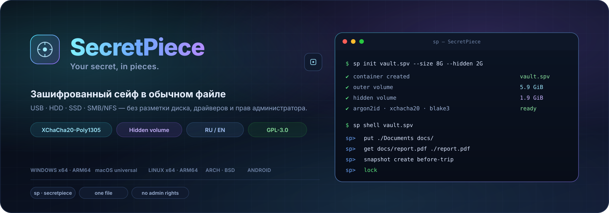
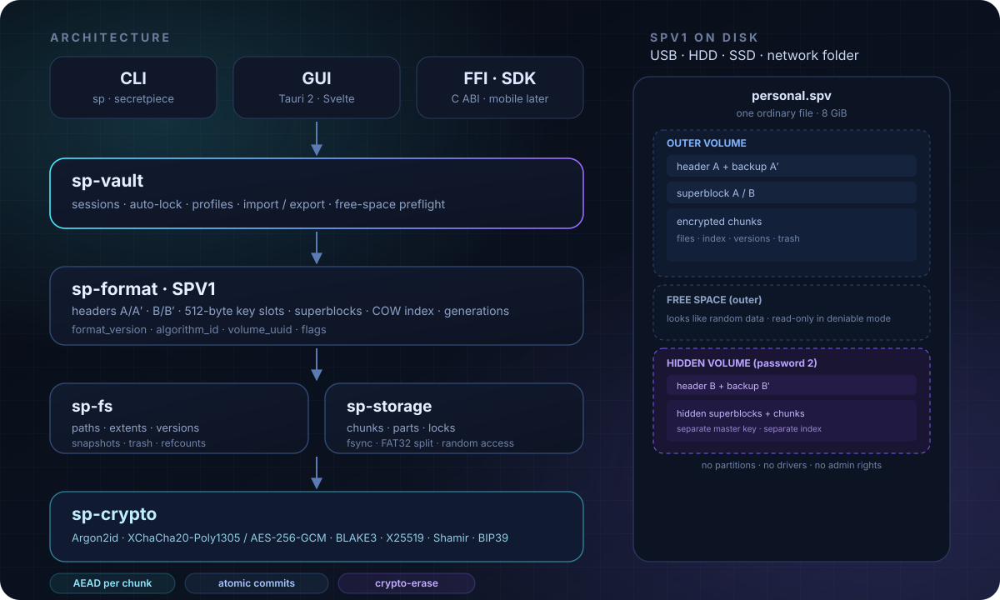
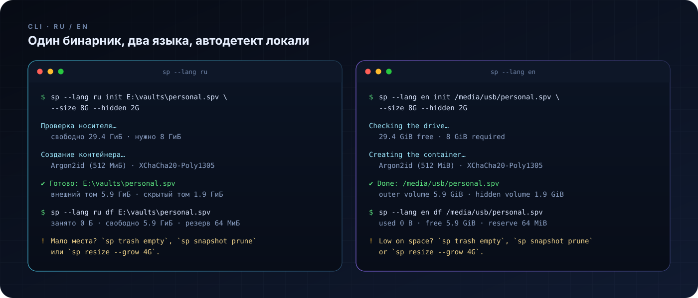

<p align="center">
  
</p>

<p align="center">
  <a href="README.md"></a>
  <a href="README.en.md"></a>
</p>

<p align="center">
  <a href="https://github.com/AmazingCoderA/secretpiece/actions/workflows/ci.yml"></a>
  <a href="https://github.com/AmazingCoderA/secretpiece/actions/workflows/release.yml"></a>
  <a href="https://github.com/AmazingCoderA/secretpiece/releases"></a>
  
  
  <a href="#license"></a>
</p>

<p align="center">
  <a href="https://github.com/AmazingCoderA/secretpiece/releases/latest"></a>
  <a href="#installation"></a>
</p>

---

**SecretPiece** is a cross-platform Rust tool that creates an encrypted vault inside an ordinary file. It works on a USB stick, an external HDD/SSD, an internal disk, or a network folder. No disk partitioning, no formatting, no drivers, no administrator rights. Open source, GPL-3.0.

> 🔐 **Your secret, in pieces.** One file. Inside — an encrypted virtual volume, a hidden volume with its own password, and everything needed to survive the loss of the drive.

<p align="center">
  
  
</p>

> ⚠️ **Early stage.** Cryptography and the container format are not implemented yet. Do not store anything important in current builds.

## ✨ Why SecretPiece

| | |
|---|---|
| 🧩 **Does not break the drive** | Only regular files. MBR/GPT, boot sector and the filesystem stay untouched. |
| 💾 **Any drive** | USB stick, external HDD/SSD, internal disk, SMB/NFS. Removable media is the primary scenario. |
| 🕵️ **Hidden volume** | The area inside the container looks like free space. It opens with a separate password. |
| 🔐 **Choice of ciphers** | XChaCha20-Poly1305 by default, ChaCha20-Poly1305 and AES-256-GCM optional, parameters recorded in the header. |
| 🗂️ **Multiple formats** | Single file, split parts for FAT32, vault folder, nested container, k-of-n shards. |
| 🚀 **Every platform** | Windows x64/ARM64, macOS universal, Linux x64/ARM64, FreeBSD/OpenBSD/NetBSD, Arch Linux. |
| 🛟 **Recoverability** | Two headers, two superblocks, `doctor`, BIP39 recovery, Shamir secret sharing, snapshots. |
| 🧹 **Secure deletion** | File and free-space shred, container crypto-erase — with an honest report. |
| 🌍 **RU / EN** | Interface and hints in Russian and English, auto-detection, `--lang`. |

## 📦 Installation

<p align="center">
  <a href="#windows"></a>
  <a href="#macos"></a>
  <a href="#linux"></a>
  <a href="#arch-linux"></a>
  <a href="#bsd"></a>
</p>

All builds live in [Releases](https://github.com/AmazingCoderA/secretpiece/releases/latest) together with `SHA256SUMS.txt`. Every push to `main` builds fresh artifacts automatically.

### Windows

```powershell
# download secretpiece-<version>-windows-x64.zip and unpack it
.\sp.exe --version
.\sp.exe --help
```

Windows ARM64 — the `windows-arm64` archive. Portable build: nothing is written to the registry, the config stays next to the binary.

### macOS

```bash
# universal: Intel + Apple Silicon
tar -xzf secretpiece-<version>-macos-universal.tar.gz
xattr -dr com.apple.quarantine ./sp
./sp --version
```

### Linux

```bash
# static musl, no dependencies
tar -xzf secretpiece-<version>-linux-x64.tar.gz
./sp --version
```

ARM64 — `linux-arm64`. Works on Ubuntu 22.04+, Fedora, Debian, Arch, Alpine.

### Arch Linux

```bash
# ready-made pacman package from Releases (x86_64)
sudo pacman -U secretpiece-1.1-1-x86_64.pkg.tar.zst

# AUR (once the recipe is published)
yay -S secretpiece-bin    # prebuilt binary
yay -S secretpiece        # build from source
# or: paru -S secretpiece-bin

# manually from source
git clone https://github.com/AmazingCoderA/secretpiece.git
cd secretpiece/packaging/arch
makepkg -si
```

Recipes: [`packaging/arch/PKGBUILD`](packaging/arch/PKGBUILD),
[`packaging/aur/secretpiece-bin`](packaging/aur/secretpiece-bin/PKGBUILD) and
[`packaging/aur/secretpiece`](packaging/aur/secretpiece/PKGBUILD). Releases ship
both an `arch-x64` archive and a real `.pkg.tar.zst`.

### BSD

```sh
# FreeBSD
pkg install rust
git clone https://github.com/AmazingCoderA/secretpiece.git
cd secretpiece && cargo build --release --locked -p sp-cli

# OpenBSD
pkg_add rust

# NetBSD
pkgin install rust
```

BSD builds in CI are marked experimental: a release still ships even if a BSD VM runner is unavailable.

## 🔐 Encryption

| Layer | Algorithm | Status |
|---|---|---|
| Data and metadata | **XChaCha20-Poly1305** (256-bit key, 192-bit nonce) | default |
| Alternative | **ChaCha20-Poly1305** (RFC 8439, 96-bit nonce) | optional |
| Alternative | **AES-256-GCM** (AES-NI / ARMv8 Crypto) | optional |
| Alternative | **AES-256-GCM-SIV** (nonce-misuse resistant) | optional, later |
| Password KDF | **Argon2id**: light 256 MiB · default 512 MiB · paranoid 1 GiB | v1.2 |
| Hashing and MAC | **BLAKE3** (keyed mode) | v1.2 |
| Key exchange | **X25519** for recipient slots | v1.5 |
| Recovery | **BIP39** (24 words) + **Shamir** k-of-n | v1.5 |
| Unlock slots | password · keyfile · FIDO2 hmac-secret · recovery · X25519 | v1.2–v1.5 |
| Manifest signatures | **Ed25519** (releases only, not volumes) | v2.0 |

- `algorithm_id` and all KDF parameters are written into the header; silent changes are forbidden.
- Changing the algorithm is only possible through `sp migrate`, which creates a new container.
- No custom ciphers, ECB, CBC without MAC, SHA-1/MD5, or "obfuscation instead of encryption".
- Slots and header payload are indistinguishable from random data without the key.

## 🗂️ Container formats

| Format | What is created | Constraints |
|---|---|---|
| **SPV1 · single file** | one `*.spv` | up to 4 TiB, best for exFAT/NTFS/APFS/ext4 |
| **SPV1 · split** | `*.spv.000`, `.001`, … | FAT32, 3.5 GiB parts |
| **Vault folder (L2)** | folder of blocks + index | convenient for cloud and large volumes |
| **Nested (L4)** | container inside the outer volume | no free-space overlap |
| **Sharded (L5)** | k-of-n Reed-Solomon shards | each part < 4 GiB, no FAT32 split |
| **Archive export** | encrypted copy for backup | requires password/recovery |

## 🗺️ Architecture

<p align="center">
  
</p>

```
0x00000  header A       ← outer volume
0x10000  header A'      ← backup
0x20000  header B       ← hidden volume
0x30000  header B'      ← backup
0x40000  superblock A
0x50000  superblock B
0x60000  chunks…        ← data and metadata
N−hidden hidden area    ← overlaps free space (deniable)
```

## 🎛️ Storage modes

| Level | What it is | When to use |
|---|---|---|
| **L1 · Sealed file** | a single `*.spv` | backups, cloud, transfer |
| **L2 · Vault folder** | a folder of blocks + index | large volumes, sync |
| **L3 · Hidden volume** | outer + hidden volume at the end of the file | the main mode for USB drives |
| **L4 · Nested vault** | a container inside the outer volume | no free-space overlap |
| **L5 · Sharded vault** | k-of-n Reed-Solomon shards | disaster recovery, split storage |
| **L6 · Paranoid** | L3/L5 + snapshots + 2FA + replicas | maximum durability |

Durability profiles: **Fast** · **Balanced** (default) · **Paranoid** · **Custom**. A profile changes versioning, trash and verification policy — never cryptography or the format.

## 🚀 Quick start

```bash
# interface language: ru or en (auto-detected from the system locale)
sp --lang en init E:\vaults\personal.spv --size 8G --hidden 2G --profile balanced
sp shell E:\vaults\personal.spv

sp> put .\Documents docs/
sp> get docs/report.pdf .\report.pdf
sp> snapshot create before-trip
sp> shred docs/old.pdf --passes 3
sp> lock
```

GUI comes after the format stabilizes (Tauri 2 + Svelte).

## 🌍 Languages

- Russian and English — complete, including hints and error messages.
- Auto-detection: `LC_ALL`, `LC_MESSAGES`, `LANG`, `SP_LANG`.
- Explicit: `sp --lang ru …` or `sp --lang en …`.
- In the GUI — a switcher in settings and on the unlock screen.
- New languages — through resource files, without touching the core.

<p align="center">
  
</p>

## 🧯 When you run out of space

SecretPiece checks free space **before** writing and never leaves partial commits. If space runs out:

| Situation | What the app does | What the user should do |
|---|---|---|
| Less than 10% free | warning + progress | empty the trash, delete old versions |
| 0 bytes free | refuses **before** writing, code `E_NOSPC` (9), volume → read-only | free space or grow the container |
| Import larger than free space | preflight refusal, no garbage | import in parts or into the outer volume |
| Media actually full | `E_NOSPC`, read-only, index stays intact | empty trash/snapshots, export data |
| FAT32 and a file > 4 GiB | automatic split into 3.5 GiB parts | use exFAT/NTFS |
| Need more capacity | `sp resize` (planned v1.4) | create a new container and move data |

Hints are everywhere: in CLI errors, in `sp df`, in the GUI banner, and in `sp doctor --explain`. A 64 MiB reserve is always kept for metadata and superblocks.

## 🛡️ Security

- The app makes **no network calls** and collects no telemetry.
- Passwords and keys never appear in argv, logs, or temporary files.
- The hidden volume is indistinguishable from random data without the password, **but the presence of a container file cannot be hidden**.
- Overwriting on flash/SSD does not guarantee physical destruction because of wear leveling. The reliable option is **crypto-erase**.
- Vulnerabilities: privately via [GitHub Security Advisories](https://github.com/AmazingCoderA/secretpiece/security/advisories/new), see [`SECURITY.md`](SECURITY.md).

## 🖥️ Platforms and architectures

| OS | Ready builds | Status |
|---|---|---|
| Windows 10/11 | x64, ARM64 | v1.1 |
| macOS 13+ | universal (Intel + Apple Silicon) | v1.1 |
| Linux | x64, ARM64 (static musl) | v1.1 |
| Arch Linux | x64, pacman package, PKGBUILD, AUR (yay/paru) | v1.1 |
| FreeBSD | x64 (VM build) | experimental |
| OpenBSD | x64 (VM build) | experimental |
| NetBSD | x64 (VM build) | experimental |
| Linux ARMv7 / RISC-V | build from source | planned v1.3 |

## 🛠️ Build and releases

```bash
git clone https://github.com/AmazingCoderA/secretpiece.git
cd secretpiece
cargo build --workspace
cargo test --workspace
cargo run -p sp-cli --bin sp -- --version
```

Requires Rust stable (MSRV **1.85**, edition 2024).

- **Auto-build** — on every push to `main` and every PR: artifacts on the workflow run page.
- **Release** — on a `v*` tag: archives + `SHA256SUMS.txt` in GitHub Releases.
- **Release assets:** `windows-x64`, `windows-arm64`, `linux-x64`, `linux-arm64`, `macos-universal`, `arch-x64`, `secretpiece-<ver>-1-x86_64.pkg.tar.zst` + `SHA256SUMS.txt`.
- Versions — `1.1`, `1.2`, `1.3`, `2.0` (no micro-patch tags).

## 📚 Documentation

| Document | Contents |
|---|---|
| [SECURITY.md](SECURITY.md) | vulnerability disclosure, scope, guarantees |
| [CONTRIBUTING.md](CONTRIBUTING.md) | development and review rules |
| [ADR](docs/ADR/README.md) | architecture decision records |
| [CHANGELOG.md](CHANGELOG.md) | change history |

The byte-level format spec (`docs/FORMAT.md`) and crypto design (`docs/CRYPTO.md`) will land together with v1.2.

## 🧭 Roadmap

| Version | Status | Outcome |
|---|---|---|
| **v1.1** | ✅ | skeleton, CI, auto-build, GPL-3.0, RU/EN, any drive |
| **v1.2** | ⏳ | crypto core and SPV1 format: Argon2id, XChaCha20-Poly1305, slots, chunks |
| **v1.3** | ⏳ | CLI and filesystem: `init/open/ls/put/get/rm`, extents, index, FAT32 split, ARMv7/RISC-V |
| **v1.4** | ⏳ | reliability: COW, snapshots, trash, `doctor`, resize, crash tests |
| **v1.5** | ⏳ | hidden volume, recovery, Shamir, X25519 recipient slots |
| **v1.6** | ⏳ | shred, free-space wipe, destroy, Reed-Solomon sharding |
| **v1.7** | ⏳ | GUI: Tauri 2 + Svelte, creation wizard, file manager |
| **v2.0** | ⏳ | hardening, fuzzing, Miri, external audit, signatures, SBOM |

## 🤝 Contributing

The project is open to review, fuzzing and audit. Read [`CONTRIBUTING.md`](CONTRIBUTING.md) before opening a PR. Cryptographic and format changes require an ADR first.

## License

**GNU General Public License v3.0 only** (GPL-3.0-only). Full text: [`LICENSE`](LICENSE).

Dual-use tool. Use it only to protect your own data and within the law. The authors are not liable for data loss, misuse, or crypto-export restrictions in your jurisdiction.

## Download

<p align="center">
  <a href="https://github.com/AmazingCoderA/secretpiece/releases/latest"></a>
  <a href="https://github.com/AmazingCoderA/secretpiece/releases/latest"></a>
  <a href="https://github.com/AmazingCoderA/secretpiece/releases/latest"></a>
  <a href="https://github.com/AmazingCoderA/secretpiece/releases/latest"></a>
</p>

<p align="center"><sub>encrypted USB vault · hidden volume · VeraCrypt alternative · Rust · GPL-3.0 · open source</sub></p>

---

<p align="center">
  <a href="README.md"></a>
  <a href="README.en.md"></a>
</p>

<p align="center">
  <sub>Made with ❤️ and paranoia · <b>SecretPiece</b> · Your secret, in pieces.</sub>
</p>
