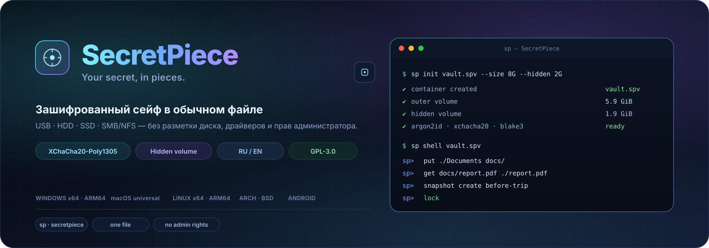
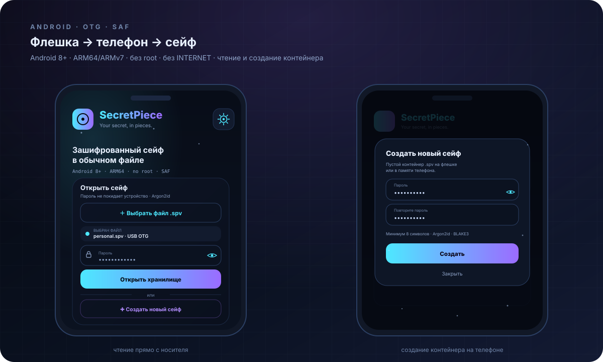
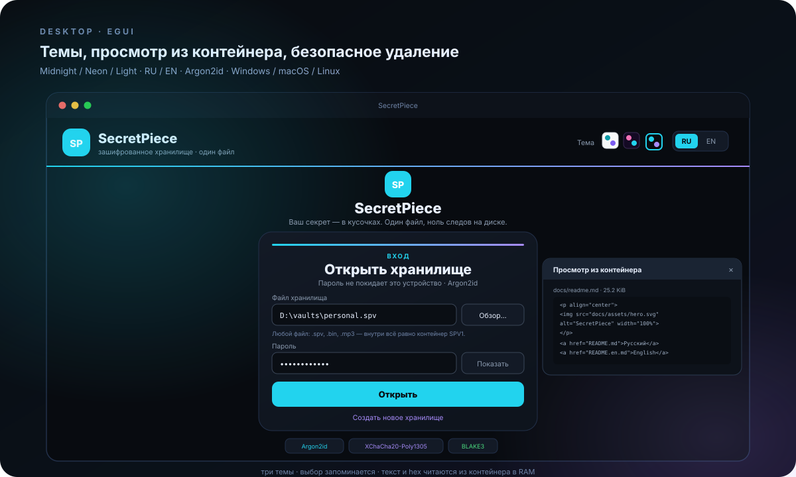
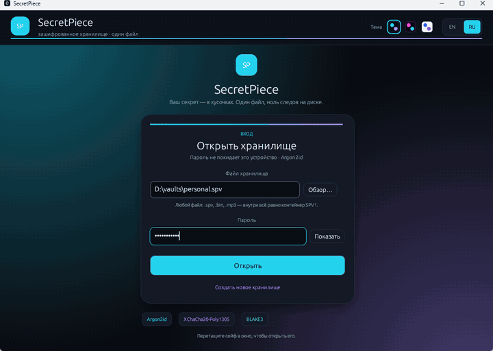
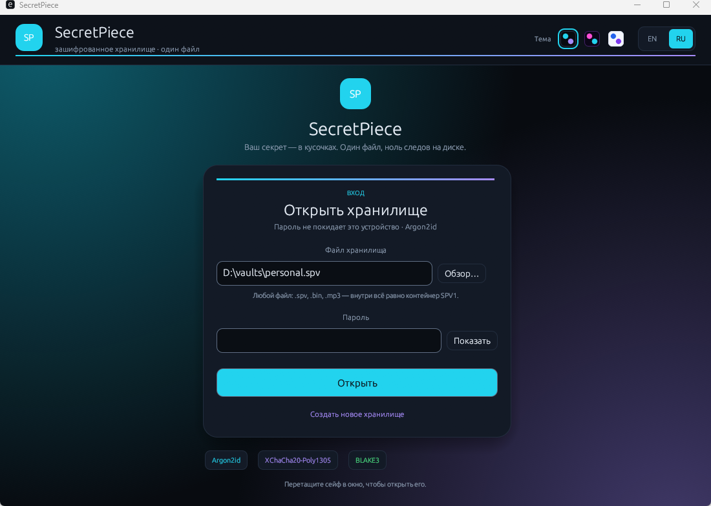
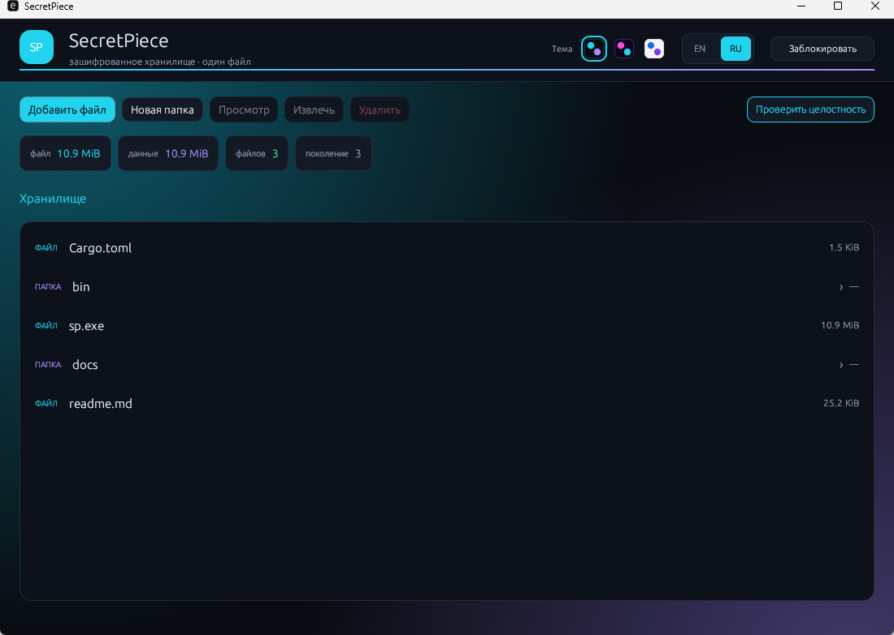
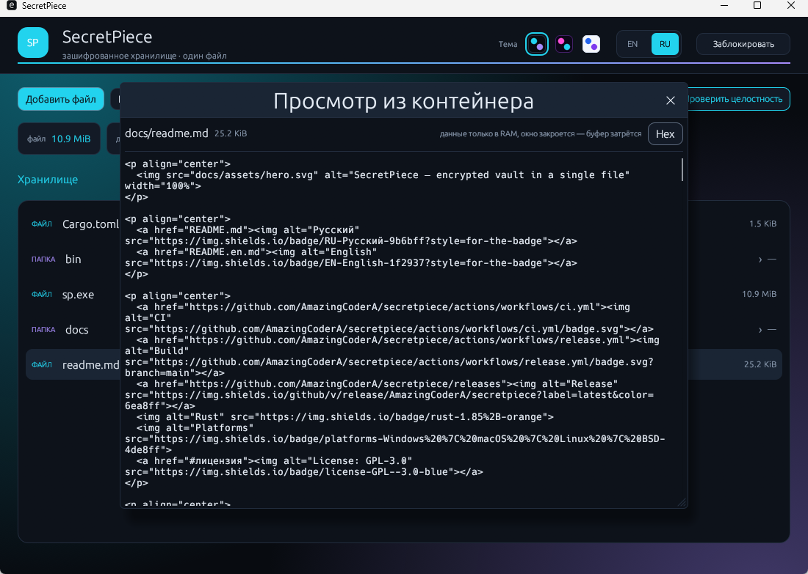
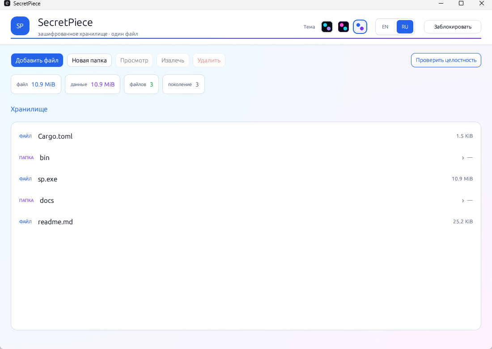
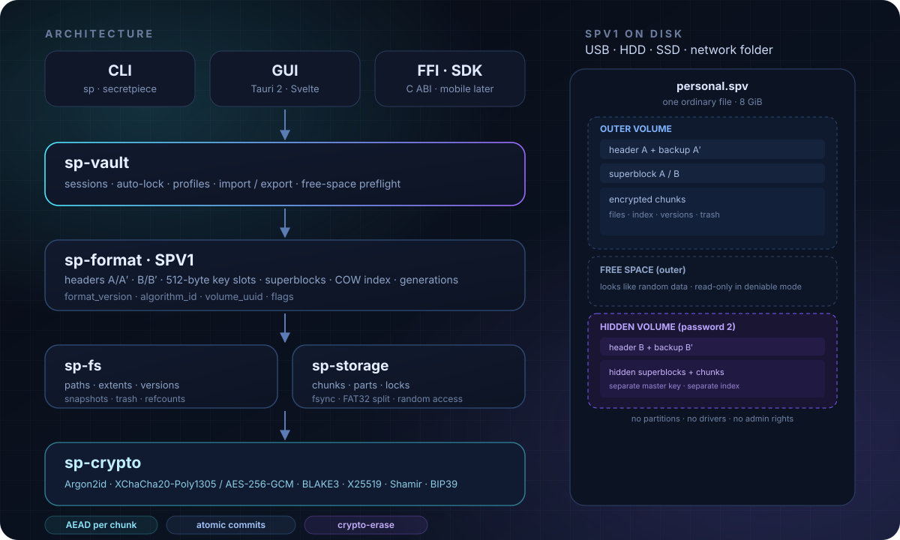
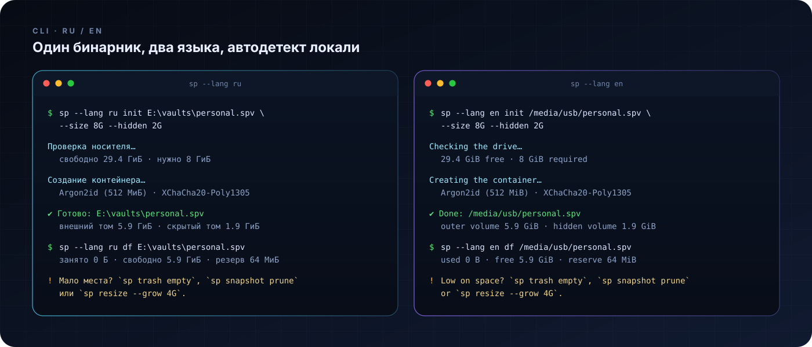

<p align="center">
  
</p>

<p align="center">
  <a href="README.md"></a>
  <a href="README.en.md"></a>
</p>

<p align="center">
  <a href="https://github.com/AmazingCoderA/secretpiece/actions/workflows/ci.yml"></a>
  <a href="https://github.com/AmazingCoderA/secretpiece/actions/workflows/release.yml"></a>
  <a href="https://github.com/AmazingCoderA/secretpiece/releases"></a>
  
  
  <a href="#license"></a>
</p>

<p align="center">
  <a href="https://github.com/AmazingCoderA/secretpiece/releases/latest"></a>
  <a href="#installation"></a>
</p>

---

**SecretPiece** is a cross-platform Rust tool that creates an encrypted vault inside an ordinary file. It works on a USB stick, an external HDD/SSD, an internal disk, or a network folder. No disk partitioning, no formatting, no drivers, no administrator rights. Open source, GPL-3.0.

> 🔐 **Your secret, in pieces.** One file. Inside — an encrypted virtual volume with folders and files you can carry on a USB stick and open on any system.

<p align="center">
  
  
</p>

> ⚠️ **Beta.** The SPV1 format and the crypto core are implemented and covered by
> tests, but no external audit has been performed yet. Keep a backup of the container.

## ✨ Why SecretPiece

| | |
|---|---|
| 🧩 **Does not break the drive** | Only regular files. MBR/GPT, boot sector and the filesystem stay untouched. |
| 💾 **Any drive** | USB stick, external HDD/SSD, internal disk, SMB/NFS. Removable media is the primary scenario. |
| 🕵️ **Hidden volume** | Planned: a separate area inside the container. Not implemented yet. |
| 🔐 **Ciphers** | XChaCha20-Poly1305 + Argon2id + BLAKE3. Parameters live in the header; changing the scheme requires the future `sp migrate`. |
| 🗂️ **Formats** | One file with any extension: `.mp4`, `.png`, `.docx`, `.md`, `.opus`… Inside it is always an SPV1 container. |
| 🚀 **Every platform** | Windows x64/ARM64, macOS universal, Linux x64/ARM64, FreeBSD/OpenBSD/NetBSD, Arch Linux, `.deb`/`.rpm`, Flatpak. |
| 🤖 **Android** | APK: USB drive over OTG, SAF + JNI, on-device vault creation, RU/EN, disguise, snow/rain/sun. |
| 🛟 **Recoverability** | Two headers, two superblocks, `doctor`, full integrity verification. The Shamir k-of-n core ships in `sp-crypto`; the UI is next. |
| 🧹 **Secure deletion** | File and free-space shred, container crypto-erase — with an honest report. |
| 🎨 **Live interface** | Seven themes (Midnight, Neon, Light, Paper, Mint, Sunset, Forest), gradient accents, responsive layout, in-vault text/hex preview, drag & drop into the window. |
| ⚡ **Speed and size** | 1 MiB chunks, index up to 256 MiB; the volume is limited only by free disk space. Older vaults still open. |
| 🎛️ **Tunable** | Sort by name/size/date/kind, 1–7 wipe passes, per-vault settings, server presets. |
| 🎬 **Any format** | Text, JSON, FB2, CSV/TSV (with a table view) and code stay in the app (wrap, copy, hex); video, images, EPUB and archives open from a temp folder after a warning and are wiped on close. |
| 🖥️ **SSH / FTP server** | Presets, key or ssh-agent automatically, FTP login and password; download/upload/create a vault on the server. |
| 📁 **Folders and tree** | Vault tree, nested folders, multi-select and move to any folder. |
| 🌍 **RU / EN** | Interface, hints and built-in help in Russian and English, auto-detection, `--lang`. |

## 📦 Installation

<p align="center">
  <a href="#windows"></a>
  <a href="#macos"></a>
  <a href="#android"></a>
  <a href="#linux"></a>
  <a href="#arch-linux"></a>
  <a href="#flatpak"></a>
  <a href="#bsd"></a>
</p>

All builds live in [Releases](https://github.com/AmazingCoderA/secretpiece/releases/latest) together with `SHA256SUMS.txt`. Every push to `main` builds fresh artifacts automatically.

### Windows

```powershell
# GUI: secretpiece-<version>-windows-x64-gui.zip → sp.exe / secretpiece.exe
# CLI: secretpiece-<version>-windows-x64-cli.zip → sp-cli.exe
.\sp.exe                          # desktop application
.\sp-cli.exe --version            # console
```

Windows ARM64 — the `windows-arm64-cli` archive. Portable build: nothing is written to the registry, the config stays next to the binary.

### macOS

```bash
# universal: Intel + Apple Silicon
tar -xzf secretpiece-<version>-macos-universal-gui.tar.gz   # sp / secretpiece
tar -xzf secretpiece-<version>-macos-universal-cli.tar.gz   # sp-cli
xattr -dr com.apple.quarantine ./sp ./secretpiece ./sp-cli
./sp
```

### Android

```bash
# APK from Releases
adb install -r secretpiece-<version>-android.apk
```

Or enable "Install unknown apps" and open the APK on the phone (Android 8+,
ARM64). Scenario: USB drive over OTG/USB-C → "Choose container file" → password →
work with files. A new empty vault is created right there: "Create new vault" →
password and confirmation → "Save as" to the drive or phone storage. No root, no
`INTERNET` permission. Settings hold the language, an optional **calculator
disguise**, a home-screen shortcut, and an ambient background: snow, rain or
sun. Details: [`docs/ANDROID.md`](docs/ANDROID.md), and on the format itself:
[`docs/SPV.md`](docs/SPV.md).

> The APK talks to the shared core through `sp-ffi`: the SAF descriptor is passed
> directly, so files are read from the drive without copying the container into
> app storage, and a new container is written straight to the medium.

<p align="center">
  
</p>

### Create a vault

**On a PC:** launch `sp` → "Create a new vault" → file name (anything:
`personal.mp4`, `backup.bin`, `song.mp3`), password and confirmation, Argon2id
hardness (16 / 64 / 256 MiB). The container is written immediately; the format
inside is SPV1.

The top bar switches themes (Midnight / Neon / Light / Paper / Mint / Sunset /
Forest) and language; the choice is remembered. Double-click a file to preview it
(text or hex) straight from the container, "Verify integrity" decrypts and
authenticates every file, and deleting can optionally overwrite each chunk with
random bytes first.

**On a phone:** "Create new vault" → password and confirmation → "Save as" to
the USB drive or phone storage.

Disguise changes only the name and extension: the contents stay an encrypted
SPV1 container. The GUI file dialog lists **all** files, not just `*.spv`, so a
disguised vault opens through "Browse…" like any other.

<p align="center">
  
</p>

### Demo

A short recording of the real app: unlocking a vault, switching themes,
previewing `readme.md` straight from the container, and verifying integrity.

<p align="center">
  
</p>

<p align="center">
  <a href="docs/assets/demo.mp4">▶ Open the MP4 demo (no sound, ~30 s)</a>
</p>

| Unlock | Vault |
| --- | --- |
|  |  |
| **In-vault preview** | **Light theme** |
|  |  |

### Linux

```bash
# separate archives: GUI and CLI
tar -xzf secretpiece-<version>-linux-x64-gui.tar.gz   # sp, secretpiece
tar -xzf secretpiece-<version>-linux-x64-cli.tar.gz   # sp-cli
./sp                  # GUI
./sp-cli --version    # CLI
```

ARM64 — `linux-arm64-cli` and `linux-arm64-gui` (GUI is built against glibc).
ARMv7 and RISC-V 64 — `linux-armv7-cli` and `linux-riscv64-cli`.
The CLI is static musl: it runs on Ubuntu 22.04+, Fedora, Debian, Arch and Alpine.
A dedicated Alpine archive is `alpine-x64-cli`.

### Arch Linux

```bash
# ready-made pacman package from Releases (x86_64)
sudo pacman -U secretpiece-1.5-1-x86_64.pkg.tar.zst

# AUR (once the recipe is published)
yay -S secretpiece-bin    # prebuilt binary
yay -S secretpiece        # build from source
# or: paru -S secretpiece-bin

# manually from source
git clone https://github.com/AmazingCoderA/secretpiece.git
cd secretpiece/packaging/arch
makepkg -si
```

Recipes: [`packaging/arch/PKGBUILD`](packaging/arch/PKGBUILD),
[`packaging/aur/secretpiece-bin`](packaging/aur/secretpiece-bin/PKGBUILD) and
[`packaging/aur/secretpiece`](packaging/aur/secretpiece/PKGBUILD). Releases ship
both an `arch-x64` archive and a real `.pkg.tar.zst`.

### Debian, Ubuntu, Fedora

```bash
# Debian / Ubuntu / Mint
sudo apt install ./secretpiece-1.5-linux-x64.deb

# Fedora / RHEL / openSUSE
sudo dnf install ./secretpiece-1.5-linux-x64.rpm
```

The packages install `sp`, `secretpiece`, a menu entry and an icon; dependencies
are `libx11`, `libxkbcommon`, `libgl`, `libegl` and `libwayland-client`.

### Windows: installed or portable

`secretpiece-1.19-windows-x64-gui.zip` is the **portable** build: extract it and
run `secretpiece.exe`. The archive also ships `install.ps1`, a user-level
installer (no admin rights) that copies the files to
`%LOCALAPPDATA%\Programs\SecretPiece` and creates a desktop shortcut:

```powershell
powershell -ExecutionPolicy Bypass -File install.ps1
```

Linux/macOS GUI archives are portable too; `.deb`/`.rpm` are available for Linux.

### Flatpak

The ready-made bundle is a GitHub release asset. A Flathub submission is open
([PR #11302](https://github.com/flathub/flathub/pull/11302)); once merged the
page will be <https://flathub.org/apps/dev.secretpiece.SecretPiece>. Until then
`flatpak search secretpiece` finds nothing.

```bash
# ready-made bundle from Releases
flatpak install --user ./secretpiece-1.19-x86_64.flatpak
flatpak run dev.secretpiece.SecretPiece
```

The sandbox can reach the home directory and removable drives, so a vault on a
USB stick opens through "Browse…" as usual. Build the bundle yourself:

```bash
git archive --prefix=src/ -o packaging/flatpak/secretpiece-src.tar.gz HEAD
flatpak-builder --user --force-clean --repo=flatpak-repo \
  --default-branch=stable build-flatpak packaging/flatpak/dev.secretpiece.SecretPiece.yml
flatpak build-bundle flatpak-repo secretpiece.flatpak dev.secretpiece.SecretPiece stable
```

The manifest and metadata live in [`packaging/flatpak`](packaging/flatpak).

### BSD

```sh
# FreeBSD
pkg install rust
git clone https://github.com/AmazingCoderA/secretpiece.git
cd secretpiece && cargo build --release --locked -p sp-cli

# OpenBSD
pkg_add rust

# NetBSD
pkgin install rust
```

BSD builds in CI are marked experimental: a release still ships even if a BSD VM runner is unavailable.

## 🔐 Encryption

| Layer | Algorithm | Status |
|---|---|---|
| Data and metadata | **XChaCha20-Poly1305** (256-bit key, 192-bit nonce) | ✅ |
| Password KDF | **Argon2id**: light 16 MiB · default 64 MiB · paranoid 256 MiB | ✅ |
| Hashing and MAC | **BLAKE3** (headers and integrity checks) | ✅ |
| Cipher migration | `sp migrate` is not implemented yet; `algorithm_id` is fixed | ⏳ v2.0 |

- `algorithm_id` and all KDF parameters are written into the header; silent changes are forbidden.
- Migration between ciphers is manual for now: extract the files, create a new container, put them back.
  An automatic `sp migrate` is on the roadmap.
- No custom ciphers, ECB, CBC without MAC, SHA-1/MD5, or "obfuscation instead of encryption".
- Slots and header payload are indistinguishable from random data without the key.

## 🗂️ Container formats

| Format | What is created | Constraints |
|---|---|---|
| **SPV1 · single file** | one file with any extension (`.mp4`, `.png`, `.docx`…) | limited by free space; index up to 256 MiB |
| **SPV1 · split** | `*.000`, `.001`, … | planned, not implemented |
| **Vault folder (L2)** | folder of blocks + index | planned, not implemented |
| **Nested (L4)** | container inside the outer volume | planned, not implemented |
| **Sharded (L5)** | k-of-n Reed-Solomon shards | planned, not implemented |
| **Archive export** | encrypted copy for backup | planned, not implemented |

## 🗺️ Architecture

<p align="center">
  
</p>

```
0x00000  header A
0x10000  header A'      ← backup
0x20000  header B       ← spare slot
0x30000  header B'      ← backup
0x40000  superblock A
0x50000  superblock B
0x60000  chunks…        ← data and metadata
```

## 🎛️ Storage modes

| Level | What it is | When to use |
|---|---|---|
| **L1 · Sealed file** | a single file with any extension | backups, cloud, transfer |
| **L2 · Vault folder** | a folder of blocks + index | planned, not implemented |
| **L3 · Hidden volume** | outer + hidden volume at the end of the file | planned, not implemented |
| **L4 · Nested vault** | a container inside the outer volume | planned, not implemented |
| **L5 · Sharded vault** | k-of-n Reed-Solomon shards | planned, not implemented |
| **L6 · Paranoid** | L3/L5 + snapshots + 2FA + replicas | planned, not implemented |

Durability profiles: **Fast** · **Balanced** (default) · **Paranoid** · **Custom**. A profile changes versioning, trash and verification policy — never cryptography or the format.

## 🚀 Quick start

```bash
# CLI: password via prompt, SP_PASSWORD, or --password-stdin
sp-cli init personal.mp4
sp-cli put personal.mp4 .\Documents\report.pdf docs/report.pdf
sp-cli ls personal.mp4
sp-cli get personal.mp4 docs/report.pdf .\report.pdf
sp-cli df personal.mp4
sp-cli verify personal.mp4

# GUI: a separate application
sp                              # Midnight / Neon / Light / Paper / Mint / Sunset / Forest, RU/EN
sp D:\vaults\personal.mp4       # open a vault straight from a file manager
```

The password is never stored: the key is derived with Argon2id and lives only in
memory. The container is a regular file with any extension and can be renamed to `report.pdf`.

Theme and language live in the top bar and are remembered between launches. A
file can be previewed (text or hex) straight from the container — the data stays
in RAM. When deleting, enable "Shred data" to overwrite every chunk with random
bytes before the file is removed.

## 🌍 Languages

- Russian and English — complete, including hints and error messages.
- Auto-detection: `LC_ALL`, `LC_MESSAGES`, `LANG`, `SP_LANG`.
- Explicit: `sp-cli --lang ru …` or `sp-cli --lang en …`.
- In the GUI — an RU/EN toggle in the header.
- New languages — through resource files, without touching the core.

<p align="center">
  
</p>

## 🧯 When you run out of space

SecretPiece checks free space **before** writing and never leaves partial commits. If space runs out:

| Situation | What the app does | What the user should do |
|---|---|---|
| Less than 10% free | warning + progress | empty the trash, delete old versions |
| 0 bytes free | refuses **before** writing, code `E_NOSPC` (9), volume → read-only | free space or grow the container |
| Import larger than free space | preflight refusal, no garbage | import in parts or into the outer volume |
| Media actually full | `E_NOSPC`, read-only, index stays intact | empty trash/snapshots, export data |
| FAT32 and a file > 4 GiB | split is not implemented yet | use exFAT/NTFS |
| Need more capacity | resize is not implemented yet | create a new container and move data |

Hints are everywhere: in `sp-cli` errors, in `sp-cli df`, in the GUI banner, and in `sp-cli doctor`. A 64 MiB reserve is always kept for metadata and superblocks.

## 🛡️ Security

- The app makes **no network calls** and collects no telemetry.
- Passwords and keys never appear in argv, logs, or temporary files.
- Container contents are indistinguishable from random data without the password, **but the presence of a container file cannot be hidden**.
- Overwriting on flash/SSD does not guarantee physical destruction because of wear leveling. The reliable option is **crypto-erase**.
- Vulnerabilities: privately via [GitHub Security Advisories](https://github.com/AmazingCoderA/secretpiece/security/advisories/new), see [`SECURITY.md`](SECURITY.md).

## 🖥️ Platforms and architectures

| OS | Ready builds | Status |
|---|---|---|
| Windows 10/11 | x64 GUI + CLI, ARM64 CLI | v1.10 |
| macOS 13+ | universal (Intel + Apple Silicon) GUI + CLI | v1.10 |
| Android 8+ | APK (SAF + JNI), ARM64/ARMv7 | v1.10 (read + create) |
| Linux | x64 GUI (glibc), x64/ARM64/ARMv7/RISC-V CLI | v1.10 |
| Debian / Ubuntu / Fedora | `.deb` and `.rpm` with GUI, menu entry and icon | v1.10 |
| Flatpak | x64 bundle, sandbox with USB access | v1.10 |
| Alpine Linux | x64 CLI (musl) | v1.10 |
| Arch Linux | x64 CLI, pacman package, PKGBUILD, AUR (yay/paru) | v1.10 |
| FreeBSD | x64 (VM build) | experimental |
| OpenBSD | x64 (VM build) | experimental |
| NetBSD | x64 (VM build) | experimental |
| Linux ARMv7 / RISC-V | prebuilt CLI (`linux-armv7-cli`, `linux-riscv64-cli`) | v1.10 |
| AppImage | portable image | planned |

## 🛠️ Build and releases

```bash
git clone https://github.com/AmazingCoderA/secretpiece.git
cd secretpiece
cargo build --workspace
cargo test --workspace
cargo run -p sp-cli --bin sp-cli -- --version   # CLI
cargo run -p sp-gui --bin sp                    # GUI (egui/eframe)
```

Requires Rust stable (MSRV **1.85**, edition 2024).

- **Auto-build** — on every push to `main` and every PR: artifacts on the workflow run page.
- **Release** — on a `v*` tag: archives + `SHA256SUMS.txt` in GitHub Releases.
- **Release assets:** `*-cli` and `*-gui` for `windows-x64`, `linux-x64`, `macos-universal`; `linux-arm64-cli`, `windows-arm64-cli`, `alpine-x64-cli`, `arch-x64-cli`, `*.pkg.tar.zst`, `android.apk` + `SHA256SUMS.txt`.
- Versions — `1.4` … `1.11`, `2.0` (no micro-patch tags).

## 📚 Documentation

| Document | Contents |
|---|---|
| [docs/SPV.md](docs/SPV.md) | what an SPV1 container is, layout, extension masking |
| [docs/ANDROID.md](docs/ANDROID.md) | Android: OTG, read + create, settings, disguise, ambience |
| [SECURITY.md](SECURITY.md) | vulnerability disclosure, scope, guarantees |
| [CONTRIBUTING.md](CONTRIBUTING.md) | development and review rules |
| [ADR](docs/ADR/README.md) | architecture decision records |
| [CHANGELOG.md](CHANGELOG.md) | change history |

The byte-level specification lives in [`docs/SPV.md`](docs/SPV.md); a separate `docs/FORMAT.md` will follow.

## 🧭 Roadmap

| Version | Status | Outcome |
|---|---|---|
| **v1.1** | ✅ | skeleton, CI, auto-build, GPL-3.0, any drive |
| **v1.2** | ✅ | visuals, RU/EN CLI, pacman/AUR, Android skeleton, Windows ARM64, Linux ARM64, BSD |
| **v1.3** | ✅ | Android: app disguise, `docs/SPV.md`, polish |
| **v1.4** | ✅ | SPV1 crypto core (Argon2id, XChaCha20-Poly1305, BLAKE3), CLI, egui GUI, Android read + on-device create, Alpine |
| **v1.5** | ✅ | Android: create-vault dialog, settings, ambience; GUI: Midnight/Neon/Light themes, workspace redesign, in-vault preview, overwrite confirmation, secure file delete; ARMv7/RISC-V CLI |
| **v1.6** | ✅ | release infrastructure, stability, fixes |
| **v1.7** | ✅ | 1 MiB chunks, drag & drop, more shells, Android share-in |
| **v1.8** | ✅ | sorting, Sunset/Forest themes, external preview with wiping, password change, SSH tab |
| **v1.9** | ✅ | create a vault on the server, FTP client, theme menu, sync on lock |
| **v1.10** | ✅ | server presets, per-vault settings, Paper/Mint themes, text viewer |
| **v1.11** | ✅ | folder tree, multi-file move, table view, RU/EN help |
| **v1.12** | ✅ | multi-file import, repeat-open fix, extraction folder choice, upload check, Shamir core |
| **v1.13** | ✅ | server session without a local copy: temp download, upload and wipe on lock |
| **v2.0** | ⏳ | `sp migrate` between ciphers, hidden volume, split/FAT32, recovery UI, fuzzing and audit |

## 🤝 Contributing

The project is open to review, fuzzing and audit. Read [`CONTRIBUTING.md`](CONTRIBUTING.md) before opening a PR. Cryptographic and format changes require an ADR first.

## License

**GNU General Public License v3.0 only** (GPL-3.0-only). Full text: [`LICENSE`](LICENSE).

Dual-use tool. Use it only to protect your own data and within the law. The authors are not liable for data loss, misuse, or crypto-export restrictions in your jurisdiction.

## Download

<p align="center">
  <a href="https://github.com/AmazingCoderA/secretpiece/releases/latest"></a>
  <a href="https://github.com/AmazingCoderA/secretpiece/releases/latest"></a>
  <a href="https://github.com/AmazingCoderA/secretpiece/releases/latest"></a>
  <a href="https://github.com/AmazingCoderA/secretpiece/releases/latest"></a>
</p>

<p align="center"><sub>encrypted USB vault · single file · Rust · GPL-3.0 · open source</sub></p>

---

<p align="center">
  <a href="README.md"></a>
  <a href="README.en.md"></a>
</p>

<p align="center">
  <sub>Made with ❤️ and paranoia · <b>SecretPiece</b> · Your secret, in pieces.</sub>
</p>
