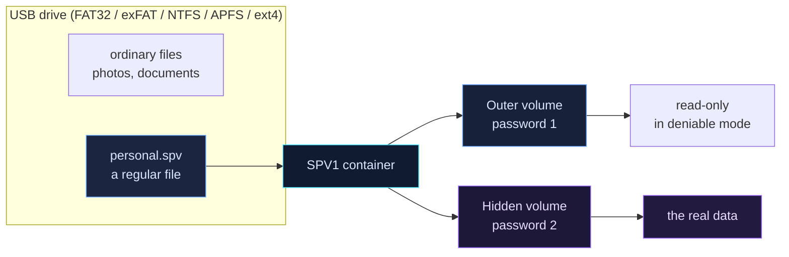

<p align="center">
  
</p>

<p align="center">
  <a href="https://github.com/AmazingCoderA/secretpiece/actions/workflows/ci.yml"></a>
  <a href="https://github.com/AmazingCoderA/secretpiece/releases"></a>
  
  
  <a href="#license"></a>
</p>

<p align="center">
  <a href="README.md">🇷🇺 Русский</a> &nbsp;·&nbsp; <b>🇬🇧 English</b>
</p>

---

**SecretPiece** is a cross-platform Rust tool that creates an encrypted vault inside an ordinary file on a USB drive. No disk partitioning, no formatting, no drivers, no administrator rights.

> 🔐 **Your secret, in pieces.** One file on a USB stick. Inside — an encrypted virtual volume, a hidden volume with its own password, and everything needed to survive the loss of the drive.

<p align="center">
  
  
</p>

> ⚠️ **Early stage.** Cryptography and the container format are not implemented yet. Do not store anything important in current builds. Specification: [`docs/TZ.ru.md`](docs/TZ.ru.md) (Russian).

## ✨ Why SecretPiece

| | |
|---|---|
| 🧩 **Does not break the drive** | Works only with regular files. MBR/GPT, boot sector and the filesystem stay untouched. |
| 🕵️ **A hidden volume, not a partition** | The area inside the container looks like free space. It opens with a separate password. |
| 💻 **One codebase — three OSes** | Windows 10/11, macOS 13+, Linux. Shared Rust core, CLI and GUI without drivers. |
| 🔒 **Honest security** | Open source, standard primitives: Argon2id, XChaCha20-Poly1305, X25519, BLAKE3. No telemetry, no network calls. |
| 🛟 **Recoverability** | Two headers, two superblocks, `doctor`, BIP39 recovery code, Shamir secret sharing. |
| 🧹 **Secure deletion** | File and free-space shred, container crypto-erase — with an honest report on flash/SSD limits. |

## 🗺️ How it works



```
0x00000  header A       ← outer volume
0x10000  header A'      ← backup
0x20000  header B       ← hidden volume
0x30000  header B'      ← backup
0x40000  superblock A
0x50000  superblock B
0x60000  chunks…        ← data and metadata
N−hidden hidden area    ← overlaps free space (deniable)
```

## 🎛️ Storage modes

| Level | What it is | When to use |
|---|---|---|
| **L1 · Sealed file** | a single `*.spv` | backups, cloud, transfer |
| **L2 · Vault folder** | a folder of blocks + index | large volumes, sync |
| **L3 · Hidden volume** | outer + hidden volume at the end of the file | the main mode for USB drives |
| **L4 · Nested vault** | a container inside the outer volume | no free-space overlap |
| **L5 · Sharded vault** | k-of-n Reed-Solomon shards | disaster recovery, split storage |
| **L6 · Paranoid** | L3/L5 + snapshots + 2FA + replicas | maximum durability |

Durability profiles: **Fast** · **Balanced** (default) · **Paranoid** · **Custom**. A profile changes versioning, trash and verification policy — never cryptography or the format.

## 🚀 Quick start (planned CLI)

```bash
# create an 8 GiB container with a 2 GiB hidden volume
sp init E:\vaults\personal.spv --size 8G --hidden 2G --profile balanced

# open an interactive shell
sp shell E:\vaults\personal.spv

sp> put .\Documents docs/
sp> get docs/report.pdf .\report.pdf
sp> snapshot create before-trip
sp> shred docs/old.pdf --passes 3
sp> lock
```

GUI comes after the format stabilizes (Tauri 2 + Svelte).

## 🛠️ Build from source

```bash
git clone https://github.com/AmazingCoderA/secretpiece.git
cd secretpiece
cargo build --workspace
cargo test --workspace
cargo run -p sp-cli --bin sp -- --version
```

Requires Rust stable (MSRV **1.85**, edition 2024).

Prebuilt binaries are published to [Releases](https://github.com/AmazingCoderA/secretpiece/releases) on every `v*` tag: Windows x64 `.zip`, Linux x64 `.tar.gz` (static musl), macOS universal `.tar.gz`, plus `SHA256SUMS.txt`.

## 🛡️ Security

- The app makes **no network calls** and collects no telemetry.
- Passwords and keys never appear in argv, logs, or temporary files.
- The hidden volume is indistinguishable from random data without the password, **but the presence of a container file cannot be hidden**.
- Overwriting on flash/SSD does not guarantee physical destruction because of wear leveling. The reliable option is **crypto-erase**.
- Vulnerabilities: privately via [GitHub Security Advisories](https://github.com/AmazingCoderA/secretpiece/security/advisories/new), see [`SECURITY.md`](SECURITY.md).

## 📚 Documentation

| Document | Contents |
|---|---|
| [Technical specification](docs/TZ.ru.md) (RU) | threat model, architecture, cryptography, SPV1 format, UX, tests, roadmap, acceptance criteria |
| [SECURITY.md](SECURITY.md) | vulnerability disclosure, scope, guarantees |
| [CONTRIBUTING.md](CONTRIBUTING.md) | development and review rules |
| [ADR](docs/ADR/README.md) | architecture decision records |
| [CHANGELOG.md](CHANGELOG.md) | change history |

## 🧭 Roadmap

| Milestone | Status | Outcome |
|---|---|---|
| **M0** — spec and skeleton | ✅ done | specification, workspace, CI, licenses, release pipeline |
| **M1** — crypto core and format | ⏳ | `sp-crypto`, `sp-format`, headers, slots, chunks, test vectors |
| **M2** — CLI and filesystem | ⏳ | `init/open/ls/put/get/rm`, extents, index, FAT32 split |
| **M3** — reliability | ⏳ | COW metadata, snapshots, trash, `doctor`, crash tests |
| **M4** — hidden volume and recovery | ⏳ | L3/L4, recovery, Shamir, recipient slots |
| **M5** — wipe and sharding | ⏳ | shred, wipe-free, destroy, Reed-Solomon |
| **M6** — GUI | ⏳ | Tauri 2 + Svelte |
| **M7** — hardening and audit | ⏳ | fuzzing, Miri, external audit, signatures |
| **M8** — v1.0 | ⏳ | releases, website, documentation |

## 🤝 Contributing

The project is open to review, fuzzing and audit. Read [`CONTRIBUTING.md`](CONTRIBUTING.md) and the spec before opening a PR. Cryptographic and format changes require an ADR first.

## 📄 License

Code — **MIT OR Apache-2.0**. Documentation — CC-BY-4.0.

Dual-use tool. Use it only to protect your own data and within the law. The authors are not liable for data loss, misuse, or crypto-export restrictions in your jurisdiction.

---

<p align="center">
  <sub>Made with ❤️ and paranoia · <b>SecretPiece</b> · Your secret, in pieces.</sub>
</p>
