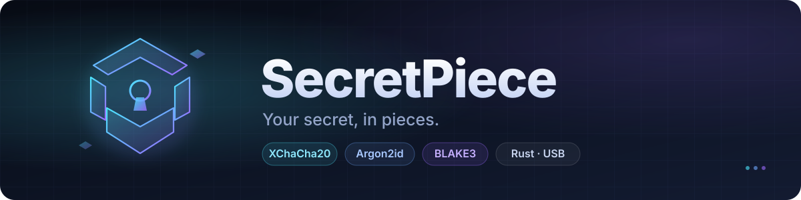
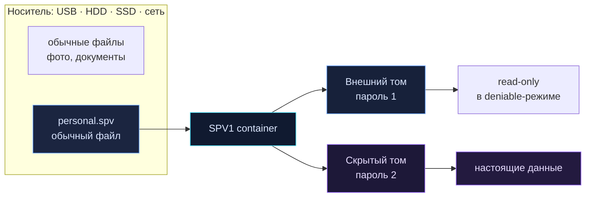

<p align="center">
  
</p>

<p align="center">
  <a href="README.md"></a>
  <a href="README.en.md"></a>
</p>

<p align="center">
  <a href="https://github.com/AmazingCoderA/secretpiece/actions/workflows/ci.yml"></a>
  <a href="https://github.com/AmazingCoderA/secretpiece/actions/workflows/release.yml"></a>
  <a href="https://github.com/AmazingCoderA/secretpiece/releases"></a>
  
  
  <a href="#лицензия"></a>
</p>

---

**SecretPiece** — кроссплатформенный инструмент на Rust для создания зашифрованного хранилища внутри обычного файла. Без разметки диска, без форматирования, без драйверов и без прав администратора.

> 🔐 **Your secret, in pieces.** Один файл. Внутри — зашифрованный виртуальный том, скрытый том с отдельным паролем и всё, что нужно, чтобы данные пережили потерю носителя.

<p align="center">
  
  
</p>

> ⚠️ **Ранняя стадия.** Криптография и формат ещё не реализованы. Не храните в текущих сборках ничего важного.

## ✨ Почему SecretPiece

| | |
|---|---|
| 🧩 **Не ломает носитель** | Работает только с обычными файлами. MBR/GPT, boot sector и файловая система не изменяются. |
| 💾 **Любой носитель** | Флешка, внешний HDD/SSD, внутренний диск, сетевая папка. Основной сценарий — съёмные USB-носители. |
| 🕵️ **Скрытый том, а не раздел** | Область внутри контейнера выглядит как свободное место. Открывается отдельным паролем. |
| 💻 **Один код — три ОС** | Windows 10/11, macOS 13+, Linux. Общее Rust-ядро, CLI и GUI без драйверов. |
| 🔒 **Честная безопасность** | Открытый код, стандартные примитивы, никакой телеметрии и сетевых вызовов. |
| 🛟 **Восстанавливаемость** | Два заголовка, два суперблока, `doctor`, recovery-код BIP39, схема Шамира. |
| 🧹 **Безопасное удаление** | Shred файлов и свободного места, crypto-erase контейнера — с честным отчётом. |

## 🔐 Шифрование

| Слой | Алгоритм | Статус |
|---|---|---|
| Данные и метаданные | **XChaCha20-Poly1305** (256-bit key, 192-bit nonce) | по умолчанию |
| Альтернативный AEAD | **AES-256-GCM** (через `algorithm_id`) | опционально, позже |
| Парольный KDF | **Argon2id**: light 256 МиБ · default 512 МиБ · paranoid 1 ГиБ | v1 |
| Хеши и MAC | **BLAKE3** (keyed mode) | v1 |
| Обмен ключами | **X25519** для слотов получателей | v1.1 |
| Recovery | **BIP39** (24 слова) + **Shamir** K из N | v1 |
| Слоты разблокировки | пароль · keyfile · FIDO2 hmac-secret · recovery · X25519 | v1 / v1.1 |

- Алгоритм и его параметры фиксируются в заголовке контейнера; менять их молча запрещено.
- `compact`-профиль допускает сжатие и переменные чанки; `balanced`/`paranoid` — фиксированные 64 КиБ.
- Свои шифры, ECB, CBC без MAC, SHA-1/MD5 и «обфускация вместо шифрования» не используются.

## 🗺️ Как это работает



```
0x00000  header A       ← внешний том
0x10000  header A'      ← резерв
0x20000  header B       ← скрытый том
0x30000  header B'      ← резерв
0x40000  superblock A
0x50000  superblock B
0x60000  chunks…        ← данные и метаданные
N−hidden hidden area    ← перекрывается свободным местом (deniable)
```

## 🎛️ Режимы хранения

| Уровень | Что это | Для чего |
|---|---|---|
| **L1 · Sealed file** | один `*.spv` | бэкапы, облако, передача |
| **L2 · Vault folder** | папка с блоками и индексом | большие объёмы, синхронизация |
| **L3 · Hidden volume** | внешний + скрытый том в конце файла | основной режим для флешки |
| **L4 · Nested vault** | контейнер внутри внешнего тома | без overlap свободного места |
| **L5 · Sharded vault** | k/n Reed-Solomon части | disaster recovery, раздельное хранение |
| **L6 · Paranoid** | L3/L5 + снапшоты + 2FA + реплики | максимальная сохранность |

Профили сохранности: **Fast** · **Balanced** (по умолчанию) · **Paranoid** · **Custom**. Профиль меняет политику версий, корзины и проверок — но не криптографию и не формат.

## 🚀 Быстрый старт (план CLI)

```bash
# создать 8 ГиБ контейнер со скрытым томом 2 ГиБ
sp init E:\vaults\personal.spv --size 8G --hidden 2G --profile balanced

# открыть интерактивную оболочку
sp shell E:\vaults\personal.spv

sp> put .\Documents docs/
sp> get docs/report.pdf .\report.pdf
sp> snapshot create before-trip
sp> shred docs/old.pdf --passes 3
sp> lock
```

GUI — после стабилизации формата (Tauri 2 + Svelte).

## 🛠️ Сборка и релизы

```bash
git clone https://github.com/AmazingCoderA/secretpiece.git
cd secretpiece
cargo build --workspace
cargo test --workspace
cargo run -p sp-cli --bin sp -- --version
```

Нужен Rust stable (MSRV **1.85**, edition 2024).

**Автосборка** запускается на каждый push в `main` и на каждый PR. Артефакты лежат на странице запуска workflow:

- `windows-x64` — `.zip`;
- `linux-x64` — `.tar.gz`, статический musl;
- `macos-universal` — `.tar.gz` для Intel и Apple Silicon.

Пуш тега `v*` дополнительно создаёт [GitHub Release](https://github.com/AmazingCoderA/secretpiece/releases) с архивами и `SHA256SUMS.txt`.

## 🛡️ Безопасность

- Приложение **не делает сетевых запросов** и не собирает телеметрию.
- Пароли и ключи не попадают в argv, логи и временные файлы.
- Скрытый том неотличим от случайных данных без пароля, **но факт наличия контейнерного файла скрыть нельзя**.
- Затирание на flash/SSD не гарантирует физическое уничтожение из-за wear leveling. Надёжный вариант — **crypto-erase**.
- Уязвимости: приватно через [GitHub Security Advisories](https://github.com/AmazingCoderA/secretpiece/security/advisories/new), см. [`SECURITY.md`](SECURITY.md).

## 📚 Документация

| Документ | О чём |
|---|---|
| [SECURITY.md](SECURITY.md) | раскрытие уязвимостей, scope, гарантии |
| [CONTRIBUTING.md](CONTRIBUTING.md) | правила разработки и ревью |
| [ADR](docs/ADR/README.md) | архитектурные решения |
| [CHANGELOG.md](CHANGELOG.md) | история изменений |

Байтовая спецификация (`docs/FORMAT.md`) и крипто-дизайн (`docs/CRYPTO.md`) появятся вместе с M1.

## 🧭 Дорожная карта

| Этап | Статус | Результат |
|---|---|---|
| **M0** — каркас | ✅ готово | workspace, CI, лицензия GPL-3.0, автосборка релизов |
| **M1** — крипто-ядро и формат | ⏳ | `sp-crypto`, `sp-format`, заголовки, слоты, чанки, тест-векторы |
| **M1.1** — выбор шифрования | ⏳ | AES-256-GCM backend, `sp migrate` |
| **M2** — CLI и ФС | ⏳ | `init/open/ls/put/get/rm`, extents, индекс, FAT32 split |
| **M3** — надёжность | ⏳ | COW-метаданные, снапшоты, корзина, `doctor`, crash-тесты |
| **M4** — скрытый том и recovery | ⏳ | L3/L4, recovery, Shamir, слоты получателей |
| **M5** — затирание и sharding | ⏳ | shred, wipe-free, destroy, Reed-Solomon |
| **M6** — GUI | ⏳ | Tauri 2 + Svelte |
| **M7** — hardening + audit | ⏳ | фаззинг, Miri, внешний аудит, подписи |
| **M8** — v1.0 | ⏳ | релизы, сайт, документация |

## 🤝 Участие

Проект открыт для ревью, фаззинга и аудита. Перед PR прочитайте [`CONTRIBUTING.md`](CONTRIBUTING.md). Криптографические и форматные изменения — только через ADR.

## Лицензия

**GNU General Public License v3.0 only** (GPL-3.0-only). Полный текст — [`LICENSE`](LICENSE).

Инструмент двойного назначения. Используйте только для защиты собственных данных и в рамках закона. Авторы не несут ответственности за потерю данных, неправомерное использование или ограничения криптоэкспорта в вашей юрисдикции.

## Скачать

<p align="center">
  <a href="https://github.com/AmazingCoderA/secretpiece/releases/latest"></a>
  <a href="https://github.com/AmazingCoderA/secretpiece/releases/latest"></a>
  <a href="https://github.com/AmazingCoderA/secretpiece/releases/latest"></a>
</p>

Все сборки — в [Releases](https://github.com/AmazingCoderA/secretpiece/releases) вместе с `SHA256SUMS.txt`. Каждый push в `main` собирает свежие артефакты автоматически.

---

<p align="center">
  <a href="README.md"></a>
  <a href="README.en.md"></a>
</p>

<p align="center">
  <sub>Сделано с ❤️ и паранойей · <b>SecretPiece</b> · Your secret, in pieces.</sub>
</p>
