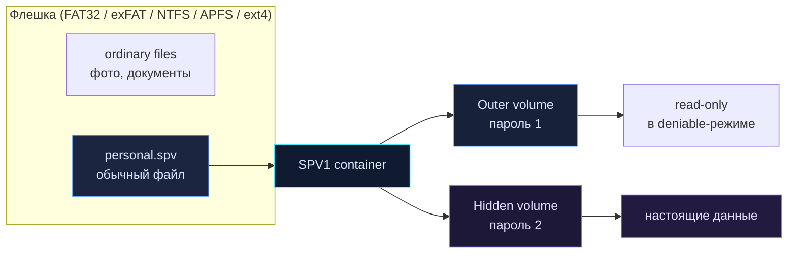

<p align="center">
  
</p>

<p align="center">
  <a href="https://github.com/AmazingCoderA/secretpiece/actions/workflows/ci.yml"></a>
  <a href="https://github.com/AmazingCoderA/secretpiece/releases"></a>
  
  
  <a href="#лицензия"></a>
</p>

<p align="center">
  <b>🇷🇺 Русский</b> &nbsp;·&nbsp; <a href="README.en.md">🇬🇧 English</a>
</p>

---

**SecretPiece** — кроссплатформенный инструмент на Rust для создания зашифрованного хранилища внутри обычного файла на флешке. Без разметки диска, без форматирования, без драйверов и без прав администратора.

> 🔐 **Your secret, in pieces.** Один файл на флешке. Внутри — зашифрованный виртуальный том, скрытый том с отдельным паролем и всё, что нужно, чтобы данные пережили потерю носителя.

<p align="center">
  
  
</p>

> ⚠️ **Ранняя стадия.** Криптография и формат ещё не реализованы. Не храните в текущих сборках ничего важного. Спецификация — [`docs/TZ.ru.md`](docs/TZ.ru.md).

## ✨ Почему SecretPiece

| | |
|---|---|
| 🧩 **Не ломает флешку** | Работает только с обычными файлами. MBR/GPT, boot sector и файловая система не изменяются. |
| 🕵️ **Скрытый том, а не раздел** | Область внутри контейнера выглядит как свободное место. Открывается отдельным паролем. |
| 💻 **Один код — три ОС** | Windows 10/11, macOS 13+, Linux. Общее Rust-ядро, CLI и GUI без драйверов. |
| 🔒 **Честная безопасность** | Открытый код, стандартные примитивы: Argon2id, XChaCha20-Poly1305, X25519, BLAKE3. Никакой телеметрии и сетевых вызовов. |
| 🛟 **Восстанавливаемость** | Два заголовка, два суперблока, `doctor`, recovery-код BIP39, схема Шамира. |
| 🧹 **Безопасное удаление** | Shred файлов и свободного места, crypto-erase контейнера — с честным отчётом об ограничениях flash/SSD. |

## 🗺️ Как это работает



```
0x00000  header A       ← внешний том
0x10000  header A'      ← резерв
0x20000  header B       ← скрытый том
0x30000  header B'      ← резерв
0x40000  superblock A
0x50000  superblock B
0x60000  chunks…        ← данные и метаданные
N−hidden hidden area    ← перекрывается свободным местом (deniable)
```

## 🎛️ Режимы хранения

| Уровень | Что это | Для чего |
|---|---|---|
| **L1 · Sealed file** | один `*.spv` | бэкапы, облако, передача |
| **L2 · Vault folder** | папка с блоками и индексом | большие объёмы, синхронизация |
| **L3 · Hidden volume** | внешний + скрытый том в конце файла | основной режим для флешки |
| **L4 · Nested vault** | контейнер внутри внешнего тома | без overlap свободного места |
| **L5 · Sharded vault** | k/n Reed-Solomon части | disaster recovery, раздельное хранение |
| **L6 · Paranoid** | L3/L5 + снапшоты + 2FA + реплики | максимальная сохранность |

Профили сохранности: **Fast** · **Balanced** (по умолчанию) · **Paranoid** · **Custom**. Профиль меняет политику версий, корзины и проверок — но не криптографию и не формат.

## 🚀 Быстрый старт (план CLI)

```bash
# создать 8 ГиБ контейнер со скрытым томом 2 ГиБ
sp init E:\vaults\personal.spv --size 8G --hidden 2G --profile balanced

# открыть интерактивную оболочку
sp shell E:\vaults\personal.spv

sp> put .\Documents docs/
sp> get docs/report.pdf .\report.pdf
sp> snapshot create before-trip
sp> shred docs/old.pdf --passes 3
sp> lock
```

GUI — после стабилизации формата (Tauri 2 + Svelte).

## 🛠️ Сборка из исходников

```bash
git clone https://github.com/AmazingCoderA/secretpiece.git
cd secretpiece
cargo build --workspace
cargo test --workspace
cargo run -p sp-cli --bin sp -- --version
```

Нужен Rust stable (MSRV **1.85**, edition 2024).

Готовые сборки появляются в [Releases](https://github.com/AmazingCoderA/secretpiece/releases) при пуше тега `v*`. Артефакты: Windows x64 `.zip`, Linux x64 `.tar.gz` (static musl), macOS universal `.tar.gz` + `SHA256SUMS.txt`.

## 🛡️ Безопасность

- Приложение **не делает сетевых запросов** и не собирает телеметрию.
- Пароли и ключи не попадают в argv, логи и временные файлы.
- Скрытый том неотличим от случайных данных без пароля, **но факт наличия контейнерного файла скрыть нельзя**.
- Затирание на flash/SSD не гарантирует физическое уничтожение из-за wear leveling. Надёжный вариант — **crypto-erase**.
- Уязвимости: приватно через [GitHub Security Advisories](https://github.com/AmazingCoderA/secretpiece/security/advisories/new), см. [`SECURITY.md`](SECURITY.md).

## 📚 Документация

| Документ | О чём |
|---|---|
| [Техническое задание](docs/TZ.ru.md) | модель угроз, архитектура, криптография, формат SPV1, UX, тесты, дорожная карта, критерии приёмки |
| [SECURITY.md](SECURITY.md) | раскрытие уязвимостей, scope, гарантии |
| [CONTRIBUTING.md](CONTRIBUTING.md) | правила разработки и ревью |
| [ADR](docs/ADR/README.md) | архитектурные решения |
| [CHANGELOG.md](CHANGELOG.md) | история изменений |

## 🧭 Дорожная карта

| Этап | Статус | Результат |
|---|---|---|
| **M0** — ТЗ и каркас | ✅ готово | спецификация, workspace, CI, лицензии, релизная сборка |
| **M1** — крипто-ядро и формат | ⏳ | `sp-crypto`, `sp-format`, заголовки, слоты, чанки, тест-векторы |
| **M2** — CLI и ФС | ⏳ | `init/open/ls/put/get/rm`, extents, индекс, FAT32 split |
| **M3** — надёжность | ⏳ | COW-метаданные, снапшоты, корзина, `doctor`, crash-тесты |
| **M4** — скрытый том и recovery | ⏳ | L3/L4, recovery, Shamir, слоты получателей |
| **M5** — затирание и sharding | ⏳ | shred, wipe-free, destroy, Reed-Solomon |
| **M6** — GUI | ⏳ | Tauri 2 + Svelte |
| **M7** — hardening + audit | ⏳ | фаззинг, Miri, внешний аудит, подписи |
| **M8** — v1.0 | ⏳ | релизы, сайт, документация |

## 🤝 Участие

Проект открыт для ревью, фаззинга и аудита. Перед PR прочитайте [`CONTRIBUTING.md`](CONTRIBUTING.md) и ТЗ. Криптографические и форматные изменения — только через ADR.

## 📄 Лицензия

Код — **MIT OR Apache-2.0**. Документация — CC-BY-4.0.

Инструмент двойного назначения. Используйте только для защиты собственных данных и в рамках закона. Авторы не несут ответственности за потерю данных, неправомерное использование или ограничения криптоэкспорта в вашей юрисдикции.

---

<p align="center">
  <sub>Сделано с ❤️ и паранойей · <b>SecretPiece</b> · Your secret, in pieces.</sub>
</p>
