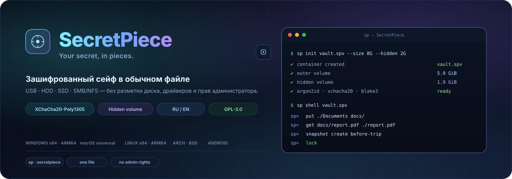
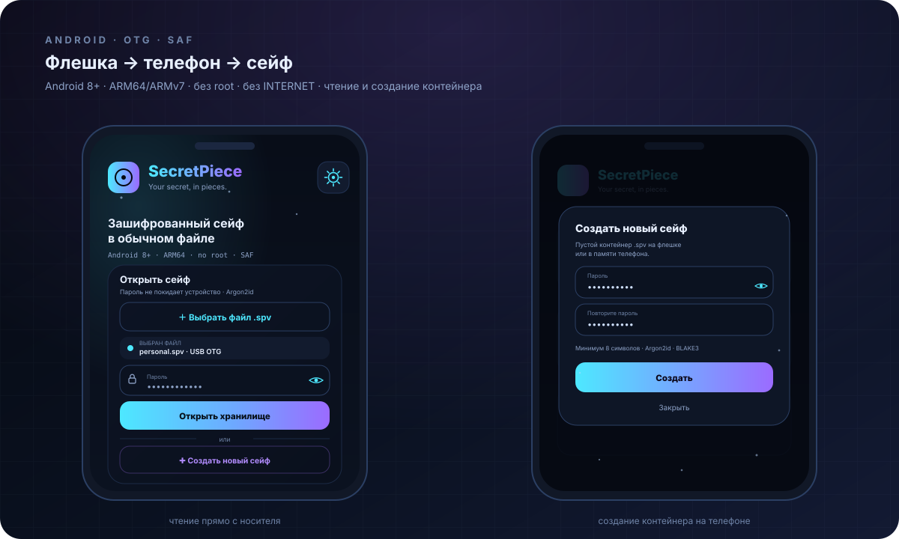
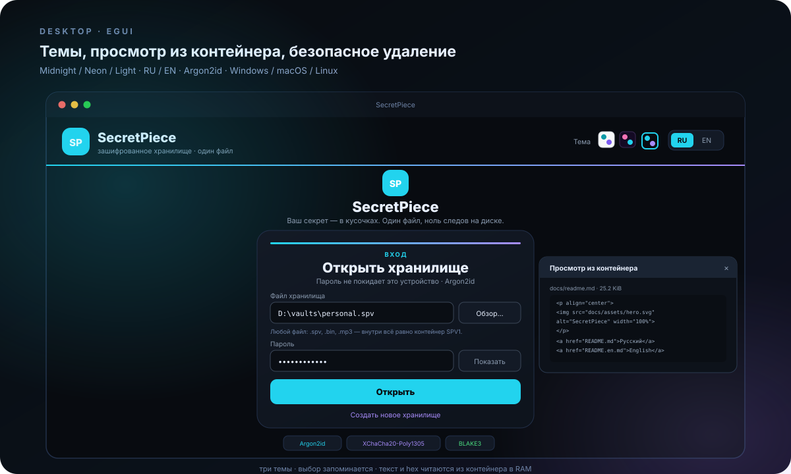
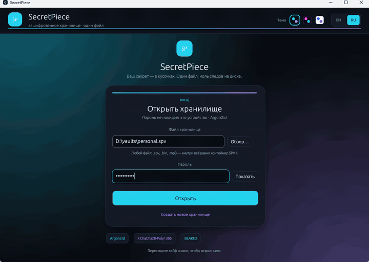
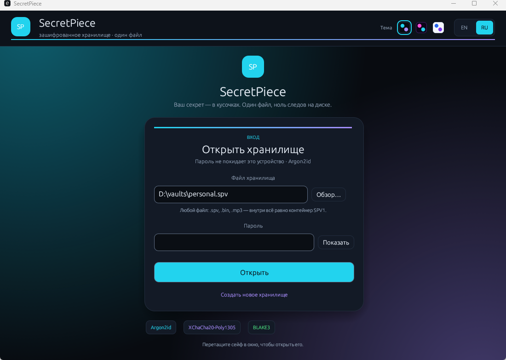
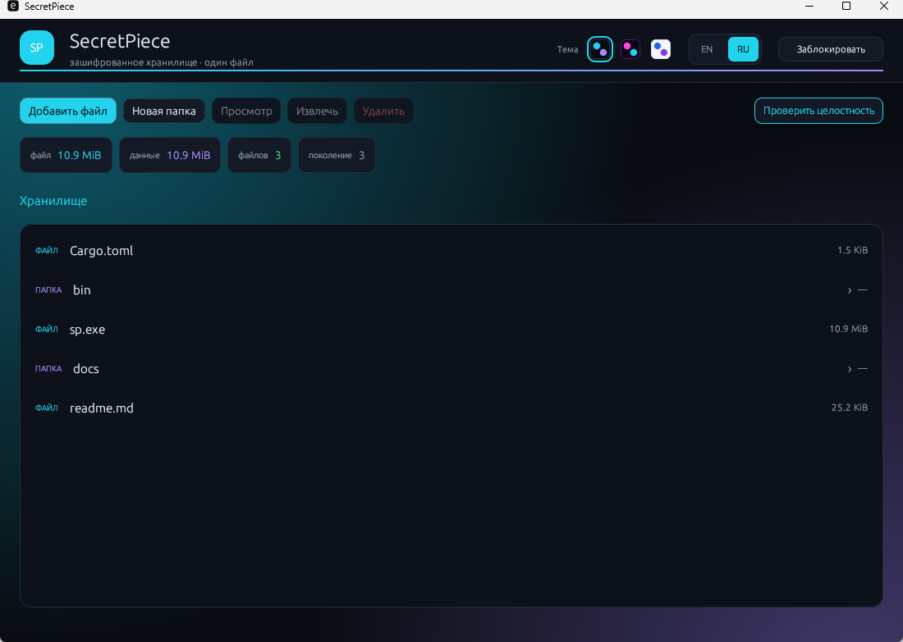
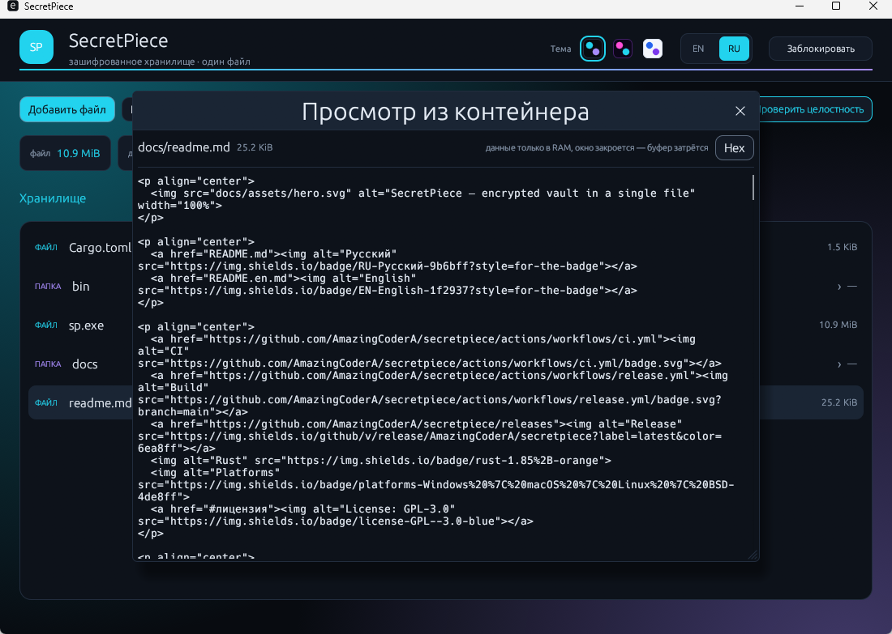
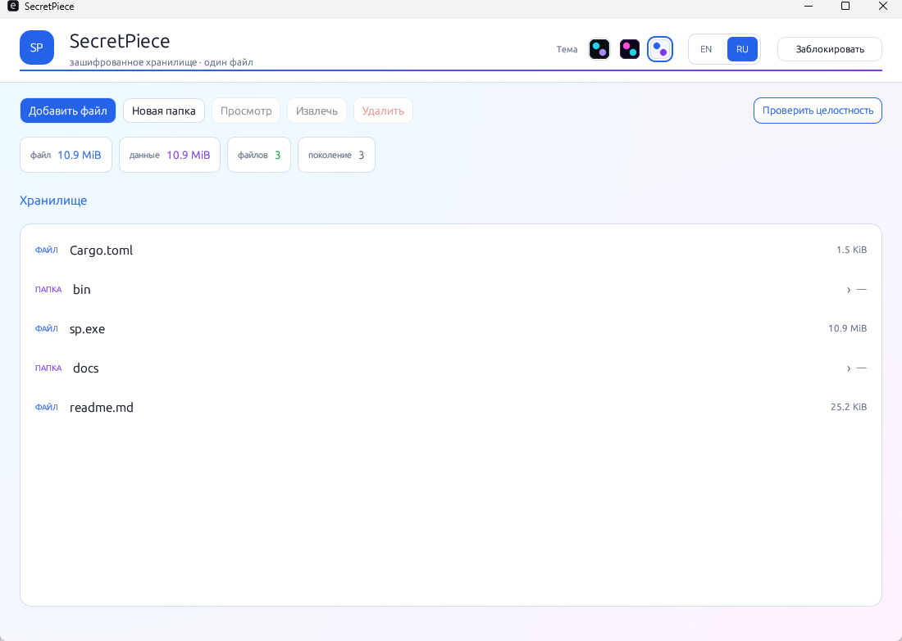
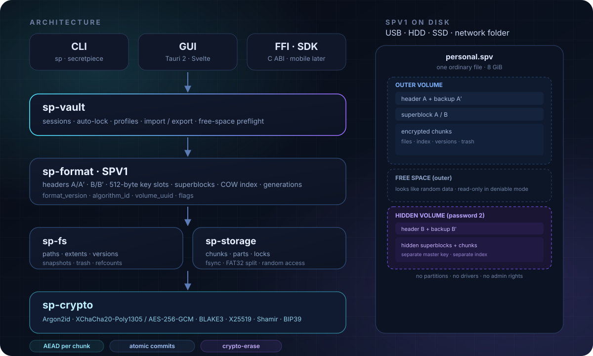
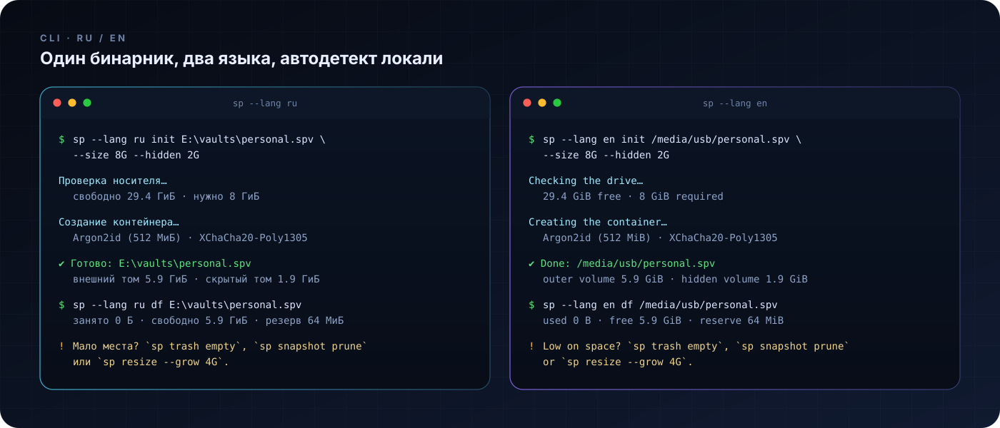

<p align="center">
  
</p>

<p align="center">
  <a href="README.md"></a>
  <a href="README.en.md"></a>
</p>

<p align="center">
  <a href="https://github.com/AmazingCoderA/secretpiece/actions/workflows/ci.yml"></a>
  <a href="https://github.com/AmazingCoderA/secretpiece/actions/workflows/release.yml"></a>
  <a href="https://github.com/AmazingCoderA/secretpiece/releases"></a>
  
  
  <a href="#лицензия"></a>
</p>

<p align="center">
  <a href="https://github.com/AmazingCoderA/secretpiece/releases/latest"></a>
  <a href="#установка"></a>
</p>

---

**SecretPiece** — кроссплатформенный инструмент на Rust для создания зашифрованного хранилища внутри обычного файла. Работает на флешке, внешнем HDD/SSD, внутреннем диске и в сетевой папке. Без разметки диска, без форматирования, без драйверов и без прав администратора. Открытый код, лицензия GPL-3.0.

> 🔐 **Your secret, in pieces.** Один файл. Внутри — зашифрованный виртуальный том, папки и файлы, которые можно носить на флешке и открывать на любой системе.

<p align="center">
  
  
</p>

> ⚠️ **Бета.** Формат SPV1 и криптоядро реализованы и покрыты тестами, но внешний
> аудит ещё не проводился. Держите резервную копию контейнера.

## ✨ Возможности

| | |
|---|---|
| 🧩 **Не ломает носитель** | Только обычные файлы. MBR/GPT, boot sector и файловая система не изменяются. |
| 💾 **Любой носитель** | USB-флешка, внешний HDD/SSD, внутренний диск, SMB/NFS. Основной сценарий — съёмные носители. |
| 🕵️ **Скрытый том** | Запланирован: отдельная область внутри контейнера, пока не реализована. |
| 🔐 **Шифрование** | XChaCha20-Poly1305 + Argon2id + BLAKE3. Параметры записаны в заголовок; смена схемы — только через будущий `sp migrate`. |
| 🗂️ **Форматы** | Один файл с произвольным расширением: `.mp4`, `.png`, `.docx`, `.md`, `.opus`… Внутри всегда контейнер SPV1. |
| 🚀 **Любые платформы** | Windows x64/ARM64, macOS universal, Linux x64/ARM64, FreeBSD/OpenBSD/NetBSD, Arch Linux, `.deb`/`.rpm`, Flatpak. |
| 🤖 **Android** | APK: флешка через OTG, SAF + JNI, создание сейфа на телефоне, RU/EN, маскировка, снег/дождь/солнце. |
| 🛟 **Восстанавливаемость** | Два заголовка, два суперблока, `doctor`, проверка целостности всех файлов. Ядро Shamir (k из n) готово в `sp-crypto`, интерфейс — впереди. |
| 🧹 **Безопасное удаление** | Shred файлов и свободного места, crypto-erase контейнера — с честным отчётом. |
| 🎨 **Живой интерфейс** | Семь тем (Midnight, Neon, Light, Paper, Mint, Sunset, Forest), градиентный акцент, адаптивная вёрстка, просмотр текста/hex, drag & drop файлов в окно. |
| ⚡ **Скорость и объём** | Кусок 1 МиБ, индекс до 256 МиБ; объём ограничен только свободным местом носителя. Старые сейфы читаются как раньше. |
| 🎛️ **Гибкая настройка** | Сортировка по имени/размеру/дате/типу, число проходов затирания 1–7, настройки контейнера, пресеты серверов. |
| 🎬 **Любой формат** | Текст, JSON, FB2, CSV/TSV (с видом таблицы), код — внутри приложения (перенос, копирование, hex); видео, фото, EPUB и архивы — во временной папке с предупреждением и затиранием. |
| 🖥️ **Сервер SSH / FTP** | Пресеты, ключ или ssh-agent автоматически, FTP с логином и паролем; скачать/загрузить/создать сейф на сервере. |
| 📁 **Папки и дерево** | Дерево контейнера, вложенные папки, отметка нескольких файлов и перемещение в любую папку. |
| 🌍 **RU / EN** | Интерфейс, подсказки и встроенная справка на русском и английском, автодетект языка, `--lang`. |

## 📦 Установка

<p align="center">
  <a href="#windows"></a>
  <a href="#macos"></a>
  <a href="#android"></a>
  <a href="#linux"></a>
  <a href="#arch-linux"></a>
  <a href="#flatpak"></a>
  <a href="#bsd"></a>
</p>

Все сборки лежат в [Releases](https://github.com/AmazingCoderA/secretpiece/releases/latest) вместе с `SHA256SUMS.txt`. Каждый push в `main` собирает свежие артефакты автоматически.

### Windows

```powershell
# GUI: secretpiece-<version>-windows-x64-gui.zip → sp.exe / secretpiece.exe
# CLI: secretpiece-<version>-windows-x64-cli.zip → sp-cli.exe
.\sp.exe                          # графическое приложение
.\sp-cli.exe --version            # консоль
```

Windows ARM64 — архив `windows-arm64-cli`. Портативная сборка: ничего не пишет в реестр, конфиг — рядом с бинарником.

### macOS

```bash
# universal: Intel + Apple Silicon
tar -xzf secretpiece-<version>-macos-universal-gui.tar.gz   # sp / secretpiece
tar -xzf secretpiece-<version>-macos-universal-cli.tar.gz   # sp-cli
xattr -dr com.apple.quarantine ./sp ./secretpiece ./sp-cli
./sp
```

### Android

```bash
# APK из Releases
adb install -r secretpiece-<version>-android.apk
```

Или включите «Установка из неизвестных источников» и откройте APK на телефоне
(Android 8+, ARM64). Сценарий: флешка через OTG/USB-C → «Выбрать файл контейнера» →
пароль → работа с файлами. Новый пустой сейф создаётся там же: «Создать новый
сейф» → пароль и повтор → «Сохранить как» на флешку или в память телефона. Без
root и без разрешения `INTERNET`. В настройках — язык, **маскировка под
калькулятор**, ярлык на главный экран и живой фон: снег, дождь или солнце.
Подробнее — [`docs/ANDROID.md`](docs/ANDROID.md), про сам формат —
[`docs/SPV.md`](docs/SPV.md).

> APK работает с ядром через `sp-ffi`: SAF-дескриптор передаётся напрямую,
> поэтому файлы читаются с флешки без копии в память приложения, а новый
> контейнер пишется сразу на носитель.

<p align="center">
  
</p>

### Создать сейф

**С ПК:** запустите `sp` → «Создать новое хранилище» → имя файла (любое:
`personal.spv`, `backup.bin`, `Бермалдинки.mp3`), пароль и повтор, стойкость
Argon2id (16 / 64 / 256 МиБ). Контейнер создаётся сразу, формат внутри — SPV1.

В шапке переключаются темы (Midnight / Neon / Light) и язык — выбор сохраняется.
Двойной клик по файлу открывает просмотр (текст или hex) прямо из контейнера,
«Проверить целостность» расшифровывает и проверяет каждый файл, а при удалении
можно включить затирание кусков случайными байтами.

**С телефона:** «Создать новый сейф» → пароль и повтор → «Сохранить как» на
флешку или в память телефона.

Маскировка меняет только имя и расширение: содержимое остаётся зашифрованным
контейнером SPV1. Проводник в GUI показывает **все** файлы, не только `*.spv`,
поэтому замаскированный сейф открывается через «Обзор…» так же, как обычный.

<p align="center">
  
</p>

### Демо

Короткая запись настоящего приложения: вход в сейф, смена темы, просмотр
`readme.md` прямо из контейнера и проверка целостности.

<p align="center">
  
</p>

<p align="center">
  <a href="docs/assets/demo.mp4">▶ Открыть демо в MP4 (звука нет, ~30 с)</a>
</p>

| Экран входа | Хранилище |
| --- | --- |
|  |  |
| **Просмотр из контейнера** | **Светлая тема** |
|  |  |

### Linux

```bash
# GUI и CLI лежат в отдельных архивах
tar -xzf secretpiece-<version>-linux-x64-gui.tar.gz   # sp, secretpiece
tar -xzf secretpiece-<version>-linux-x64-cli.tar.gz   # sp-cli
./sp                  # GUI
./sp-cli --version    # CLI
```

Для ARM64 — `linux-arm64-cli` и `linux-arm64-gui` (GUI собирается под glibc).
Для ARMv7 и RISC-V 64 — `linux-armv7-cli` и `linux-riscv64-cli`.
CLI — статический musl: работает на Ubuntu 22.04+, Fedora, Debian, Arch и Alpine.
Отдельный musl-архив для Alpine — `alpine-x64-cli`.

### Arch Linux

```bash
# готовый pacman-пакет из Releases (x86_64)
sudo pacman -U secretpiece-1.5-1-x86_64.pkg.tar.zst

# AUR (после публикации рецепта)
yay -S secretpiece-bin    # готовый бинарник
yay -S secretpiece        # сборка из исходников
# или: paru -S secretpiece-bin

# вручную из исходников
git clone https://github.com/AmazingCoderA/secretpiece.git
cd secretpiece/packaging/arch
makepkg -si
```

Рецепты: [`packaging/arch/PKGBUILD`](packaging/arch/PKGBUILD),
[`packaging/aur/secretpiece-bin`](packaging/aur/secretpiece-bin/PKGBUILD) и
[`packaging/aur/secretpiece`](packaging/aur/secretpiece/PKGBUILD). В релизах есть
`arch-x64` архив и настоящий `.pkg.tar.zst`.

### Debian, Ubuntu, Fedora

```bash
# Debian / Ubuntu / Mint
sudo apt install ./secretpiece-1.5-linux-x64.deb

# Fedora / RHEL / openSUSE
sudo dnf install ./secretpiece-1.5-linux-x64.rpm
```

Пакеты ставят `sp`, `secretpiece`, пункт меню и иконку; зависимости —
`libx11`, `libxkbcommon`, `libgl`, `libegl`, `libwayland-client`.

### Flatpak

```bash
# готовый bundle из Releases
flatpak install --user ./secretpiece-1.5-x86_64.flatpak
flatpak run dev.secretpiece.SecretPiece
```

Песочница получает доступ к домашнему каталогу и съёмным носителям, поэтому
сейф на флешке открывается через «Обзор…» как обычно. Собрать bundle самому:

```bash
git archive --prefix=src/ -o packaging/flatpak/secretpiece-src.tar.gz HEAD
flatpak-builder --user --force-clean --repo=flatpak-repo \
  --default-branch=stable build-flatpak packaging/flatpak/dev.secretpiece.SecretPiece.yml
flatpak build-bundle flatpak-repo secretpiece.flatpak dev.secretpiece.SecretPiece stable
```

Манифест и метаданные — в [`packaging/flatpak`](packaging/flatpak).

### BSD

```sh
# FreeBSD
pkg install rust
git clone https://github.com/AmazingCoderA/secretpiece.git
cd secretpiece && cargo build --release --locked -p sp-cli

# OpenBSD
pkg_add rust

# NetBSD
pkgin install rust
```

BSD-сборки в CI помечены как экспериментальные: релиз выходит, даже если VM-раннер BSD недоступен.

## 🔐 Шифрование

| Слой | Алгоритм | Статус |
|---|---|---|
| Данные и метаданные | **XChaCha20-Poly1305** (256-bit key, 192-bit nonce) | ✅ |
| Парольный KDF | **Argon2id**: light 16 МиБ · default 64 МиБ · paranoid 256 МиБ | ✅ |
| Хеши и MAC | **BLAKE3** (заголовки и контроль целостности) | ✅ |
| Смена схемы шифрования | `sp migrate` пока не реализован; `algorithm_id` фиксирован | ⏳ v2.0 |

- `algorithm_id` и все параметры KDF записываются в заголовок; молча менять их запрещено.
- Миграция между схемами шифрования пока выполняется вручную: извлечь файлы, создать новый
  контейнер, загрузить обратно. Автоматический `sp migrate` — в дорожной карте.
- Свои шифры, ECB, CBC без MAC, SHA-1/MD5 и «обфускация вместо шифрования» не используются.
- Слоты и payload заголовка неотличимы от случайных данных без ключа.

## 🗂️ Форматы контейнера

| Формат | Что создаётся | Ограничения |
|---|---|---|
| **SPV1 · single file** | один файл с любым расширением (`.mp4`, `.png`, `.docx`…) | объём — свободное место; индекс до 256 МиБ |
| **SPV1 · split** | `*.000`, `.001`, … | план, пока не реализовано |
| **Vault folder (L2)** | папка блоков + индекс | план, пока не реализовано |
| **Nested (L4)** | контейнер внутри внешнего тома | план, пока не реализовано |
| **Sharded (L5)** | k/n Reed-Solomon шарды | план, пока не реализовано |
| **Archive export** | зашифрованная копия для бэкапа | план, пока не реализовано |

## 🗺️ Архитектура

<p align="center">
  
</p>

```
0x00000  header A
0x10000  header A'      ← резерв
0x20000  header B       ← запасной слот
0x30000  header B'      ← резерв
0x40000  superblock A
0x50000  superblock B
0x60000  chunks…        ← данные и метаданные
```

## 🎛️ Режимы хранения

| Уровень | Что это | Для чего |
|---|---|---|
| **L1 · Sealed file** | один файл с любым расширением | бэкапы, облако, передача |
| **L2 · Vault folder** | папка с блоками и индексом | план, пока не реализовано |
| **L3 · Hidden volume** | внешний + скрытый том в конце файла | план, пока не реализовано |
| **L4 · Nested vault** | контейнер внутри внешнего тома | план, пока не реализовано |
| **L5 · Sharded vault** | k/n Reed-Solomon части | план, пока не реализовано |
| **L6 · Paranoid** | L3/L5 + снапшоты + 2FA + реплики | план, пока не реализовано |

Профили сохранности: **Fast** · **Balanced** (по умолчанию) · **Paranoid** · **Custom**. Профиль меняет политику версий, корзины и проверок — но не криптографию и не формат.

## 🚀 Быстрый старт

```bash
# CLI ставьте паролем через запрос, SP_PASSWORD или --password-stdin
sp-cli init personal.mp4
sp-cli put personal.mp4 .\Documents\report.pdf docs/report.pdf
sp-cli ls personal.mp4
sp-cli get personal.mp4 docs/report.pdf .\report.pdf
sp-cli df personal.mp4
sp-cli verify personal.mp4

# GUI: отдельное приложение
sp                              # темы Midnight / Neon / Light / Paper / Mint / Sunset / Forest, RU/EN
sp D:\vaults\personal.mp4       # сразу открыть сейф из файлового менеджера
```

Пароль нигде не сохраняется: ключ выводится из него через Argon2id и живёт только
в памяти. Контейнер — один обычный файл с любым расширением, его можно переименовать в `report.pdf`.

В шапке переключаются тема и язык — выбор сохраняется между запусками. Файл можно
открыть на просмотр (текст или hex) прямо из контейнера: данные живут только в
памяти. При удалении включите «Затереть данные», чтобы куски были перезаписаны
случайными байтами перед удалением.

## 🌍 Языки

- Русский и английский — полностью, включая подсказки и сообщения об ошибках.
- Автодетект: `LC_ALL`, `LC_MESSAGES`, `LANG`, `SP_LANG`.
- Явно: `sp-cli --lang ru …` или `sp-cli --lang en …`.
- В GUI — переключатель RU/EN в шапке.
- Новые языки — через файлы ресурсов, без правки ядра.

<p align="center">
  
</p>

## 🧯 Если закончилось место

SecretPiece проверяет свободное место **до** записи и не оставляет частичных коммитов. Если место закончилось:

| Ситуация | Что делает приложение | Что делать пользователю |
|---|---|---|
| Свободно < 10% | предупреждение + прогресс | очистить корзину, удалить старые версии |
| Свободно 0 | отказ **до** записи, код `E_NOSPC` (9), том → read-only | освободить место или увеличить контейнер |
| Импорт больше свободного | preflight-отказ без мусора | импортировать частями или во внешний том |
| Кончилось место на носителе | `E_NOSPC`, read-only, без повреждения индекса | очистить корзину/снапшоты, экспортировать данные |
| FAT32 и файл > 4 ГиБ | сплит пока не реализован | использовать exFAT/NTFS |
| Нужно больше объёма | resize пока не реализован | создать новый контейнер и перенести данные |

Подсказки есть везде: в ошибках `sp-cli`, в `sp-cli df`, в GUI-баннере и в `sp-cli doctor`. Резерв 64 МиБ всегда держится под метаданные и суперблоки.

## 🛡️ Безопасность

- Приложение **не делает сетевых запросов** и не собирает телеметрию.
- Пароли и ключи не попадают в argv, логи и временные файлы.
- Содержимое контейнера неотличимо от случайных данных без пароля, **но факт наличия контейнерного файла скрыть нельзя**.
- Затирание на flash/SSD не гарантирует физическое уничтожение из-за wear leveling. Надёжный вариант — **crypto-erase**.
- Уязвимости: приватно через [GitHub Security Advisories](https://github.com/AmazingCoderA/secretpiece/security/advisories/new), см. [`SECURITY.md`](SECURITY.md).

## 🖥️ Платформы и архитектуры

| ОС | Готовые сборки | Статус |
|---|---|---|
| Windows 10/11 | x64 GUI + CLI, ARM64 CLI | v1.10 |
| macOS 13+ | universal (Intel + Apple Silicon) GUI + CLI | v1.10 |
| Android 8+ | APK (SAF + JNI), ARM64/ARMv7 | v1.10 (чтение + создание) |
| Linux | x64 GUI (glibc), x64/ARM64/ARMv7/RISC-V CLI | v1.10 |
| Debian / Ubuntu / Fedora | `.deb` и `.rpm` с GUI, меню и иконкой | v1.10 |
| Flatpak | x64 bundle, песочница, доступ к флешкам | v1.10 |
| Alpine Linux | x64 CLI (musl) | v1.10 |
| Arch Linux | x64 CLI, pacman-пакет, PKGBUILD, AUR (yay/paru) | v1.10 |
| FreeBSD | x64 (VM build) | экспериментально |
| OpenBSD | x64 (VM build) | экспериментально |
| NetBSD | x64 (VM build) | экспериментально |
| Linux ARMv7 / RISC-V | готовые CLI-сборки (`linux-armv7-cli`, `linux-riscv64-cli`) | v1.10 |
| AppImage | переносимый образ | план |

## 🛠️ Сборка и релизы

```bash
git clone https://github.com/AmazingCoderA/secretpiece.git
cd secretpiece
cargo build --workspace
cargo test --workspace
cargo run -p sp-cli --bin sp-cli -- --version   # CLI
cargo run -p sp-gui --bin sp                    # GUI (egui/eframe)
```

Нужен Rust stable (MSRV **1.85**, edition 2024).

- **Auto-build** — на каждый push в `main` и на каждый PR: артефакты на странице запуска workflow.
- **Release** — на тег `v*`: архивы + `SHA256SUMS.txt` в GitHub Releases.
- **Ассеты релиза:** `*-cli` и `*-gui` для `windows-x64`, `linux-x64`, `macos-universal`; `linux-arm64-cli`, `linux-armv7-cli`, `linux-riscv64-cli`, `windows-arm64-cli`, `alpine-x64-cli`, `arch-x64-cli`, `*.pkg.tar.zst`, `.deb`, `.rpm`, `.flatpak`, `android.apk` + `SHA256SUMS.txt`.
- Версии — `1.4` … `1.11`, `2.0` (без микро-патчей в тегах).

## 📚 Документация

| Документ | О чём |
|---|---|
| [docs/SPV.md](docs/SPV.md) | что такое контейнер SPV1, layout, маскировка расширения |
| [docs/ANDROID.md](docs/ANDROID.md) | Android: OTG, чтение и создание сейфа, настройки, маскировка, атмосфера |
| [SECURITY.md](SECURITY.md) | раскрытие уязвимостей, scope, гарантии |
| [CONTRIBUTING.md](CONTRIBUTING.md) | правила разработки и ревью |
| [ADR](docs/ADR/README.md) | архитектурные решения |
| [CHANGELOG.md](CHANGELOG.md) | история изменений |

Байтовая спецификация — [`docs/SPV.md`](docs/SPV.md); отдельный `docs/FORMAT.md` появится позже.

## 🧭 Дорожная карта

| Версия | Статус | Результат |
|---|---|---|
| **v1.1** | ✅ | каркас, CI, автосборка, GPL-3.0, любые носители |
| **v1.2** | ✅ | визуал, RU/EN CLI, pacman/AUR, Android-каркас, Windows ARM64, Linux ARM64, BSD |
| **v1.3** | ✅ | Android: маскировка приложения, `docs/SPV.md`, полировка |
| **v1.4** | ✅ | криптоядро SPV1 (Argon2id, XChaCha20-Poly1305, BLAKE3), CLI, GUI на egui, Android: чтение и создание сейфа, Alpine |
| **v1.5** | ✅ | Android: диалог создания сейфа, настройки, атмосфера; GUI: темы Midnight/Neon/Light, редизайн рабочего пространства, просмотр из контейнера, подтверждение перезаписи, безопасное удаление файла; ARMv7/RISC-V CLI |
| **v1.6** | ✅ | инфраструктура релизов, стабильность, исправления |
| **v1.7** | ✅ | куски 1 МиБ, drag & drop, больше оболочек, Android share-in |
| **v1.8** | ✅ | сортировка, темы Sunset/Forest, внешний просмотр с затиранием, смена пароля, SSH-вкладка |
| **v1.9** | ✅ | создание сейфа на сервере, FTP-клиент, меню тем, синхронизация при блокировке |
| **v1.10** | ✅ | пресеты серверов, настройки контейнера, темы Paper/Mint, просмотр текста |
| **v1.11** | ✅ | дерево папок, перемещение нескольких файлов, вид таблицы, справка RU/EN |
| **v1.12** | ✅ | мультивыбор файлов, фикс повторного открытия, выбор папки распаковки, проверка загрузки, ядро Shamir |
| **v1.13** | ✅ | сессия с сервера без локальной копии: скачал во временную, при блокировке залил и затёр |
| **v2.0** | ⏳ | `sp migrate` между схемами шифрования, скрытый том, split/FAT32, recovery UI, фаззинг и аудит |

## 🤝 Участие

Проект открыт для ревью, фаззинга и аудита. Перед PR прочитайте [`CONTRIBUTING.md`](CONTRIBUTING.md). Криптографические и форматные изменения — только через ADR.

## Лицензия

**GNU General Public License v3.0 only** (GPL-3.0-only). Полный текст — [`LICENSE`](LICENSE).

Инструмент двойного назначения. Используйте только для защиты собственных данных и в рамках закона. Авторы не несут ответственности за потерю данных, неправомерное использование или ограничения криптоэкспорта в вашей юрисдикции.

## Скачать

<p align="center">
  <a href="https://github.com/AmazingCoderA/secretpiece/releases/latest"></a>
  <a href="https://github.com/AmazingCoderA/secretpiece/releases/latest"></a>
  <a href="https://github.com/AmazingCoderA/secretpiece/releases/latest"></a>
  <a href="https://github.com/AmazingCoderA/secretpiece/releases/latest"></a>
</p>

<p align="center"><sub>encrypted USB vault · single file · Rust · GPL-3.0 · open source</sub></p>

---

<p align="center">
  <a href="README.md"></a>
  <a href="README.en.md"></a>
</p>

<p align="center">
  <sub>Сделано с ❤️ и паранойей · <b>SecretPiece</b> · Your secret, in pieces.</sub>
</p>
