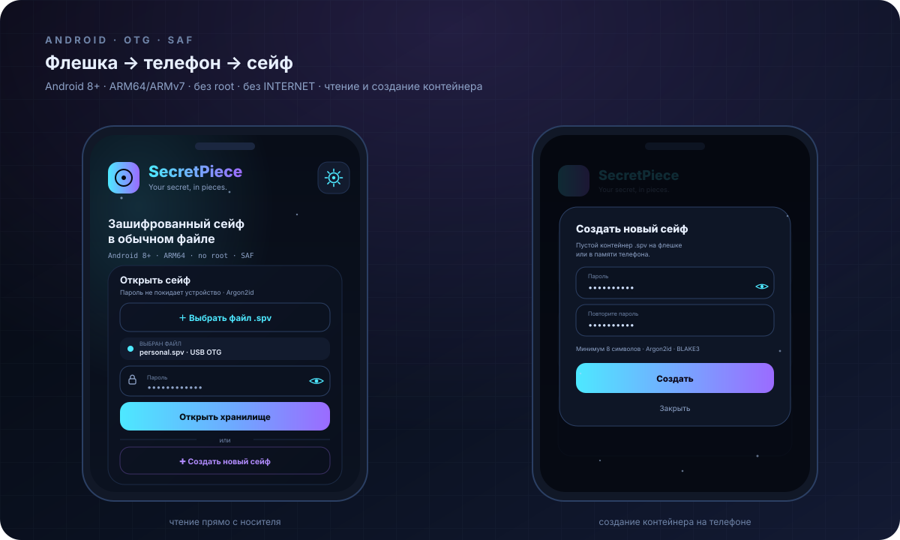
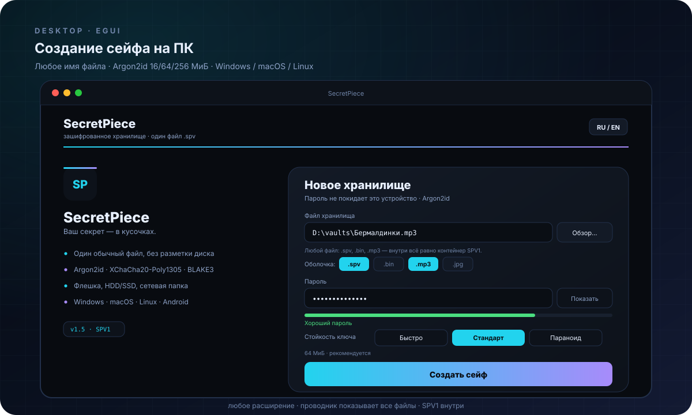

<p align="center">
  
</p>

<p align="center">
  <a href="README.md"></a>
  <a href="README.en.md"></a>
</p>

<p align="center">
  <a href="https://github.com/AmazingCoderA/secretpiece/actions/workflows/ci.yml"></a>
  <a href="https://github.com/AmazingCoderA/secretpiece/actions/workflows/release.yml"></a>
  <a href="https://github.com/AmazingCoderA/secretpiece/releases"></a>
  
  
  <a href="#лицензия"></a>
</p>

<p align="center">
  <a href="https://github.com/AmazingCoderA/secretpiece/releases/latest"></a>
  <a href="#установка"></a>
</p>

---

**SecretPiece** — кроссплатформенный инструмент на Rust для создания зашифрованного хранилища внутри обычного файла. Работает на флешке, внешнем HDD/SSD, внутреннем диске и в сетевой папке. Без разметки диска, без форматирования, без драйверов и без прав администратора. Открытый код, лицензия GPL-3.0.

> 🔐 **Your secret, in pieces.** Один файл. Внутри — зашифрованный виртуальный том, скрытый том с отдельным паролем и всё, что нужно, чтобы данные пережили потерю носителя.

<p align="center">
  
  
</p>

> ⚠️ **Бета.** Формат SPV1 и криптоядро реализованы и покрыты тестами, но внешний
> аудит ещё не проводился. Держите резервную копию контейнера.

## ✨ Возможности

| | |
|---|---|
| 🧩 **Не ломает носитель** | Только обычные файлы. MBR/GPT, boot sector и файловая система не изменяются. |
| 💾 **Любой носитель** | USB-флешка, внешний HDD/SSD, внутренний диск, SMB/NFS. Основной сценарий — съёмные носители. |
| 🕵️ **Скрытый том** | Область внутри контейнера выглядит как свободное место. Открывается отдельным паролем (план v1.8). |
| 🔐 **Шифрование** | XChaCha20-Poly1305 уже в v1.4; ChaCha20-Poly1305 и AES-256-GCM — позже, параметры в заголовке. |
| 🗂️ **Разные форматы** | Один файл, набор частей для FAT32, папка-хранилище, nested-контейнер, k/n shards. |
| 🚀 **Любые платформы** | Windows x64/ARM64, macOS universal, Linux x64/ARM64, FreeBSD/OpenBSD/NetBSD, Arch Linux. |
| 🤖 **Android** | APK: флешка через OTG, SAF + JNI, создание сейфа на телефоне, RU/EN, маскировка, снег/дождь/солнце. |
| 🛟 **Восстанавливаемость** | Два заголовка, два суперблока, `doctor`, recovery BIP39, схема Шамира, снапшоты. |
| 🧹 **Безопасное удаление** | Shred файлов и свободного места, crypto-erase контейнера — с честным отчётом. |
| 🌍 **RU / EN** | Интерфейс и подсказки на русском и английском, автодетект языка, `--lang`. |

## 📦 Установка

<p align="center">
  <a href="#windows"></a>
  <a href="#macos"></a>
  <a href="#android"></a>
  <a href="#linux"></a>
  <a href="#arch-linux"></a>
  <a href="#bsd"></a>
</p>

Все сборки лежат в [Releases](https://github.com/AmazingCoderA/secretpiece/releases/latest) вместе с `SHA256SUMS.txt`. Каждый push в `main` собирает свежие артефакты автоматически.

### Windows

```powershell
# GUI: secretpiece-<version>-windows-x64-gui.zip → sp.exe / secretpiece.exe
# CLI: secretpiece-<version>-windows-x64-cli.zip → sp-cli.exe
.\sp.exe                          # графическое приложение
.\sp-cli.exe --version            # консоль
```

Windows ARM64 — архив `windows-arm64-cli`. Портативная сборка: ничего не пишет в реестр, конфиг — рядом с бинарником.

### macOS

```bash
# universal: Intel + Apple Silicon
tar -xzf secretpiece-<version>-macos-universal-gui.tar.gz   # sp / secretpiece
tar -xzf secretpiece-<version>-macos-universal-cli.tar.gz   # sp-cli
xattr -dr com.apple.quarantine ./sp ./secretpiece ./sp-cli
./sp
```

### Android

```bash
# APK из Releases
adb install -r secretpiece-<version>-android.apk
```

Или включите «Установка из неизвестных источников» и откройте APK на телефоне
(Android 8+, ARM64). Сценарий: флешка через OTG/USB-C → «Выбрать файл .spv» →
пароль → работа с файлами. Новый пустой сейф создаётся там же: «Создать новый
сейф» → пароль и повтор → «Сохранить как» на флешку или в память телефона. Без
root и без разрешения `INTERNET`. В настройках — язык, **маскировка под
калькулятор**, ярлык на главный экран и живой фон: снег, дождь или солнце.
Подробнее — [`docs/ANDROID.md`](docs/ANDROID.md), про сам формат —
[`docs/SPV.md`](docs/SPV.md).

> APK работает с ядром через `sp-ffi`: SAF-дескриптор передаётся напрямую,
> поэтому файлы читаются с флешки без копии в память приложения, а новый
> контейнер пишется сразу на носитель.

<p align="center">
  
</p>

### Создать сейф

**С ПК:** запустите `sp` → «Создать новое хранилище» → имя файла (любое:
`personal.spv`, `backup.bin`, `Бермалдинки.mp3`), пароль и повтор, стойкость
Argon2id (16 / 64 / 256 МиБ). Контейнер создаётся сразу, формат внутри — SPV1.

**С телефона:** «Создать новый сейф» → пароль и повтор → «Сохранить как» на
флешку или в память телефона.

Маскировка меняет только имя и расширение: содержимое остаётся зашифрованным
контейнером SPV1. Проводник в GUI показывает **все** файлы, не только `*.spv`,
поэтому замаскированный сейф открывается через «Обзор…» так же, как обычный.

<p align="center">
  
</p>

### Linux

```bash
# GUI и CLI лежат в отдельных архивах
tar -xzf secretpiece-<version>-linux-x64-gui.tar.gz   # sp, secretpiece
tar -xzf secretpiece-<version>-linux-x64-cli.tar.gz   # sp-cli
./sp                  # GUI
./sp-cli --version    # CLI
```

Для ARM64 — `linux-arm64-cli` и `linux-arm64-gui` (GUI собирается под glibc).
Для ARMv7 и RISC-V 64 — `linux-armv7-cli` и `linux-riscv64-cli`.
CLI — статический musl: работает на Ubuntu 22.04+, Fedora, Debian, Arch и Alpine.
Отдельный musl-архив для Alpine — `alpine-x64-cli`.

### Arch Linux

```bash
# готовый pacman-пакет из Releases (x86_64)
sudo pacman -U secretpiece-1.5-1-x86_64.pkg.tar.zst

# AUR (после публикации рецепта)
yay -S secretpiece-bin    # готовый бинарник
yay -S secretpiece        # сборка из исходников
# или: paru -S secretpiece-bin

# вручную из исходников
git clone https://github.com/AmazingCoderA/secretpiece.git
cd secretpiece/packaging/arch
makepkg -si
```

Рецепты: [`packaging/arch/PKGBUILD`](packaging/arch/PKGBUILD),
[`packaging/aur/secretpiece-bin`](packaging/aur/secretpiece-bin/PKGBUILD) и
[`packaging/aur/secretpiece`](packaging/aur/secretpiece/PKGBUILD). В релизах есть
`arch-x64` архив и настоящий `.pkg.tar.zst`.

### BSD

```sh
# FreeBSD
pkg install rust
git clone https://github.com/AmazingCoderA/secretpiece.git
cd secretpiece && cargo build --release --locked -p sp-cli

# OpenBSD
pkg_add rust

# NetBSD
pkgin install rust
```

BSD-сборки в CI помечены как экспериментальные: релиз выходит, даже если VM-раннер BSD недоступен.

## 🔐 Шифрование

| Слой | Алгоритм | Статус |
|---|---|---|
| Данные и метаданные | **XChaCha20-Poly1305** (256-bit key, 192-bit nonce) | ✅ v1.4 |
| Парольный KDF | **Argon2id**: light 16 МиБ · default 64 МиБ · paranoid 256 МиБ | ✅ v1.4 |
| Хеши и MAC | **BLAKE3** (заголовки и контроль целостности) | ✅ v1.4 |
| Альтернатива | **ChaCha20-Poly1305** (RFC 8439, 96-bit nonce) | опционально, позже |
| Альтернатива | **AES-256-GCM** (AES-NI / ARMv8 Crypto) | опционально, позже |
| Альтернатива | **AES-256-GCM-SIV** (nonce-misuse resistant) | опционально, позже |
| Обмен ключами | **X25519** для слотов получателей | v1.8 |
| Recovery | **BIP39** (24 слова) + **Shamir** K из N | v1.8 |
| Слоты разблокировки | пароль · keyfile · FIDO2 hmac-secret · recovery · X25519 | v1.4–v1.8 |
| Подписи манифестов | **Ed25519** (только релизы, не тома) | v2.0 |

- `algorithm_id` и все параметры KDF записываются в заголовок; молча менять их запрещено.
- Смена алгоритма — только через `sp migrate` с созданием нового контейнера.
- Свои шифры, ECB, CBC без MAC, SHA-1/MD5 и «обфускация вместо шифрования» не используются.
- Слоты и payload заголовка неотличимы от случайных данных без ключа.

## 🗂️ Форматы контейнера

| Формат | Что создаётся | Ограничения |
|---|---|---|
| **SPV1 · single file** | один `*.spv` | до 4 ТиБ, лучший выбор для exFAT/NTFS/APFS/ext4 |
| **SPV1 · split** | `*.spv.000`, `.001`, … | FAT32, части по 3.5 ГиБ |
| **Vault folder (L2)** | папка блоков + индекс | удобно для облака и больших объёмов |
| **Nested (L4)** | контейнер внутри внешнего тома | нет overlap свободного места |
| **Sharded (L5)** | k/n Reed-Solomon шарды | каждая часть < 4 ГиБ, без FAT32-сплита |
| **Archive export** | зашифрованная копия для бэкапа | требует пароль/recovery |

## 🗺️ Архитектура

<p align="center">
  
</p>

```
0x00000  header A       ← внешний том
0x10000  header A'      ← резерв
0x20000  header B       ← скрытый том
0x30000  header B'      ← резерв
0x40000  superblock A
0x50000  superblock B
0x60000  chunks…        ← данные и метаданные
N−hidden hidden area    ← перекрывается свободным местом (deniable)
```

## 🎛️ Режимы хранения

| Уровень | Что это | Для чего |
|---|---|---|
| **L1 · Sealed file** | один `*.spv` | бэкапы, облако, передача |
| **L2 · Vault folder** | папка с блоками и индексом | большие объёмы, синхронизация |
| **L3 · Hidden volume** | внешний + скрытый том в конце файла | основной режим для флешки |
| **L4 · Nested vault** | контейнер внутри внешнего тома | без overlap свободного места |
| **L5 · Sharded vault** | k/n Reed-Solomon части | disaster recovery, раздельное хранение |
| **L6 · Paranoid** | L3/L5 + снапшоты + 2FA + реплики | максимальная сохранность |

Профили сохранности: **Fast** · **Balanced** (по умолчанию) · **Paranoid** · **Custom**. Профиль меняет политику версий, корзины и проверок — но не криптографию и не формат.

## 🚀 Быстрый старт

```bash
# CLI ставьте паролем через запрос, SP_PASSWORD или --password-stdin
sp-cli init personal.spv
sp-cli put personal.spv .\Documents\report.pdf docs/report.pdf
sp-cli ls personal.spv
sp-cli get personal.spv docs/report.pdf .\report.pdf
sp-cli df personal.spv
sp-cli verify personal.spv

# GUI: отдельное приложение
sp            # или secretpiece — тёмный интерфейс, RU/EN
```

Пароль нигде не сохраняется: ключ выводится из него через Argon2id и живёт только
в памяти. Контейнер — один обычный файл `.spv`, его можно переименовать в `report.pdf`.

## 🌍 Языки

- Русский и английский — полностью, включая подсказки и сообщения об ошибках.
- Автодетект: `LC_ALL`, `LC_MESSAGES`, `LANG`, `SP_LANG`.
- Явно: `sp-cli --lang ru …` или `sp-cli --lang en …`.
- В GUI — переключатель RU/EN в шапке.
- Новые языки — через файлы ресурсов, без правки ядра.

<p align="center">
  
</p>

## 🧯 Если закончилось место

SecretPiece проверяет свободное место **до** записи и не оставляет частичных коммитов. Если место закончилось:

| Ситуация | Что делает приложение | Что делать пользователю |
|---|---|---|
| Свободно < 10% | предупреждение + прогресс | очистить корзину, удалить старые версии |
| Свободно 0 | отказ **до** записи, код `E_NOSPC` (9), том → read-only | освободить место или увеличить контейнер |
| Импорт больше свободного | preflight-отказ без мусора | импортировать частями или во внешний том |
| Кончилось место на носителе | `E_NOSPC`, read-only, без повреждения индекса | очистить корзину/снапшоты, экспортировать данные |
| FAT32 и файл > 4 ГиБ | автосплит на части 3.5 ГиБ | использовать exFAT/NTFS |
| Нужно больше объёма | `sp-cli` resize (план v1.7) | создать новый контейнер и перенести данные |

Подсказки есть везде: в ошибках `sp-cli`, в `sp-cli df`, в GUI-баннере и в `sp-cli doctor`. Резерв 64 МиБ всегда держится под метаданные и суперблоки.

## 🛡️ Безопасность

- Приложение **не делает сетевых запросов** и не собирает телеметрию.
- Пароли и ключи не попадают в argv, логи и временные файлы.
- Скрытый том неотличим от случайных данных без пароля, **но факт наличия контейнерного файла скрыть нельзя**.
- Затирание на flash/SSD не гарантирует физическое уничтожение из-за wear leveling. Надёжный вариант — **crypto-erase**.
- Уязвимости: приватно через [GitHub Security Advisories](https://github.com/AmazingCoderA/secretpiece/security/advisories/new), см. [`SECURITY.md`](SECURITY.md).

## 🖥️ Платформы и архитектуры

| ОС | Готовые сборки | Статус |
|---|---|---|
| Windows 10/11 | x64 GUI + CLI, ARM64 CLI | v1.4 |
| macOS 13+ | universal (Intel + Apple Silicon) GUI + CLI | v1.4 |
| Android 8+ | APK (SAF + JNI), ARM64/ARMv7 | v1.5 (чтение + создание) |
| Linux | x64 GUI (glibc), x64/ARM64/ARMv7/RISC-V CLI | v1.5 |
| Alpine Linux | x64 CLI (musl) | v1.4 |
| Arch Linux | x64 CLI, pacman-пакет, PKGBUILD, AUR (yay/paru) | v1.5 |
| FreeBSD | x64 (VM build) | экспериментально |
| OpenBSD | x64 (VM build) | экспериментально |
| NetBSD | x64 (VM build) | экспериментально |
| Linux ARMv7 / RISC-V | готовые CLI-сборки (`linux-armv7-cli`, `linux-riscv64-cli`) | v1.5 |
| Flatpak / AppImage | песочница и переносимый образ | план v1.9 |

## 🛠️ Сборка и релизы

```bash
git clone https://github.com/AmazingCoderA/secretpiece.git
cd secretpiece
cargo build --workspace
cargo test --workspace
cargo run -p sp-cli --bin sp-cli -- --version   # CLI
cargo run -p sp-gui --bin sp                    # GUI (egui/eframe)
```

Нужен Rust stable (MSRV **1.85**, edition 2024).

- **Auto-build** — на каждый push в `main` и на каждый PR: артефакты на странице запуска workflow.
- **Release** — на тег `v*`: архивы + `SHA256SUMS.txt` в GitHub Releases.
- **Ассеты релиза:** `*-cli` и `*-gui` для `windows-x64`, `linux-x64`, `macos-universal`; `linux-arm64-cli`, `linux-armv7-cli`, `linux-riscv64-cli`, `windows-arm64-cli`, `alpine-x64-cli`, `arch-x64-cli`, `*.pkg.tar.zst`, `android.apk` + `SHA256SUMS.txt`.
- Версии — `1.1`, `1.2`, `1.3`, `1.4`, `1.5`, `2.0` (без микро-патчей в тегах).

## 📚 Документация

| Документ | О чём |
|---|---|
| [docs/SPV.md](docs/SPV.md) | что такое файл `.spv`, layout SPV1, маскировка имени |
| [docs/ANDROID.md](docs/ANDROID.md) | Android: OTG, чтение и создание сейфа, настройки, маскировка, атмосфера |
| [SECURITY.md](SECURITY.md) | раскрытие уязвимостей, scope, гарантии |
| [CONTRIBUTING.md](CONTRIBUTING.md) | правила разработки и ревью |
| [ADR](docs/ADR/README.md) | архитектурные решения |
| [CHANGELOG.md](CHANGELOG.md) | история изменений |

Байтовая спецификация — [`docs/SPV.md`](docs/SPV.md); отдельный `docs/FORMAT.md` появится позже.

## 🧭 Дорожная карта

| Версия | Статус | Результат |
|---|---|---|
| **v1.1** | ✅ | каркас, CI, автосборка, GPL-3.0, любые носители |
| **v1.2** | ✅ | визуал, RU/EN CLI, pacman/AUR, Android-каркас, Windows ARM64, Linux ARM64, BSD |
| **v1.3** | ✅ | Android: маскировка приложения, `docs/SPV.md`, полировка |
| **v1.4** | ✅ | криптоядро SPV1 (Argon2id, XChaCha20-Poly1305, BLAKE3), CLI, GUI на egui, Android: чтение и создание сейфа, Alpine |
| **v1.5** | ✅ | Android: диалог создания сейфа, настройки, атмосфера; GUI: редизайн создания, выбор Argon2id, маскировка файла; ARMv7/RISC-V CLI |
| **v1.6** | ⏳ | extents, FAT32 split, миграция формата |
| **v1.7** | ⏳ | надёжность: COW, снапшоты, корзина, `doctor`, resize, crash-тесты |
| **v1.8** | ⏳ | скрытый том, recovery, Shamir, слоты получателей X25519 |
| **v1.9** | ⏳ | затирание, free-space wipe, destroy, Reed-Solomon sharding |
| **v2.0** | ⏳ | GUI: мастер создания, менеджер файлов, темы; hardening, фаззинг, Miri, аудит, SBOM |

## 🤝 Участие

Проект открыт для ревью, фаззинга и аудита. Перед PR прочитайте [`CONTRIBUTING.md`](CONTRIBUTING.md). Криптографические и форматные изменения — только через ADR.

## Лицензия

**GNU General Public License v3.0 only** (GPL-3.0-only). Полный текст — [`LICENSE`](LICENSE).

Инструмент двойного назначения. Используйте только для защиты собственных данных и в рамках закона. Авторы не несут ответственности за потерю данных, неправомерное использование или ограничения криптоэкспорта в вашей юрисдикции.

## Скачать

<p align="center">
  <a href="https://github.com/AmazingCoderA/secretpiece/releases/latest"></a>
  <a href="https://github.com/AmazingCoderA/secretpiece/releases/latest"></a>
  <a href="https://github.com/AmazingCoderA/secretpiece/releases/latest"></a>
  <a href="https://github.com/AmazingCoderA/secretpiece/releases/latest"></a>
</p>

<p align="center"><sub>encrypted USB vault · hidden volume · VeraCrypt alternative · Rust · GPL-3.0 · open source</sub></p>

---

<p align="center">
  <a href="README.md"></a>
  <a href="README.en.md"></a>
</p>

<p align="center">
  <sub>Сделано с ❤️ и паранойей · <b>SecretPiece</b> · Your secret, in pieces.</sub>
</p>
