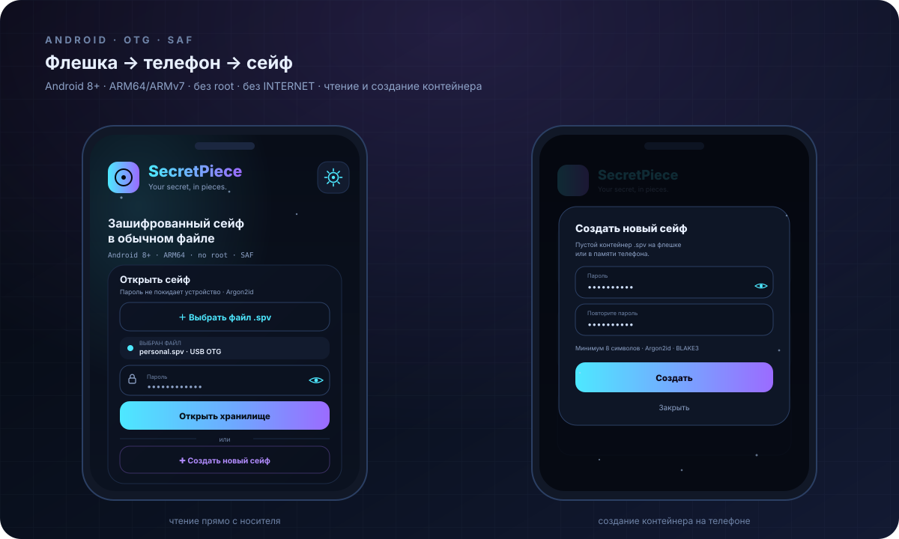

# SecretPiece for Android



Compose app that opens a `.spv` container directly from a USB drive connected
over OTG/USB-C. No root, no drivers, no `MANAGE_EXTERNAL_STORAGE`.

## Current status

| Part | Status |
|---|---|
| Compose UI (RU/EN) | ✅ |
| System file picker (SAF) | ✅ |
| Open a `.spv` from a file manager (`VIEW` intent) | ✅ |
| Password field, unlock flow | ✅ UI |
| Argon2id / XChaCha20-Poly1305 | ⏳ wired through `sp-ffi` in v1.3 |
| File browser inside the vault | ⏳ v1.3 |

Until the crypto core lands, the unlock button shows a dialog explaining that
the UI and USB access are ready and the format work is in progress. **Do not use
Android builds for real secrets yet.**

## Scenario: USB drive + phone

1. Plug the USB drive into the phone with an OTG adapter (or USB-C drive).
2. The system mounts it read/write (exFAT/NTFS/ext4/FAT32 — whatever the phone supports).
3. Tap **Choose .spv file**, pick `personal.spv` from the drive.
4. Enter the password.
5. In v1.3: browse, preview, copy files to and from the drive.

Alternatively, tap the `.spv` file in any file manager: SecretPiece registers a
`VIEW` intent and receives the content URI.

## Build

Requires JDK 17 and the Android SDK (compileSdk 34). With Gradle 8.7+:

```bash
cd android
gradle assembleDebug
# apk: app/build/outputs/apk/debug/app-debug.apk
```

Or open the `android/` folder in Android Studio.

## Security notes

- The app has **no `INTERNET` permission** — nothing leaves the device.
- Storage is accessed through the Storage Access Framework; the app receives a
  content URI, not a raw block device.
- Do not copy the container to shared storage or cloud sync folders while it is
  unlocked.
- Android may cache thumbnails or previews of exported files; prefer the in-app
  viewer in v1.3.
- USB drives can disappear mid-write (unplug, power loss). The Rust core will
  keep the same crash-safe commit model as on desktop.
