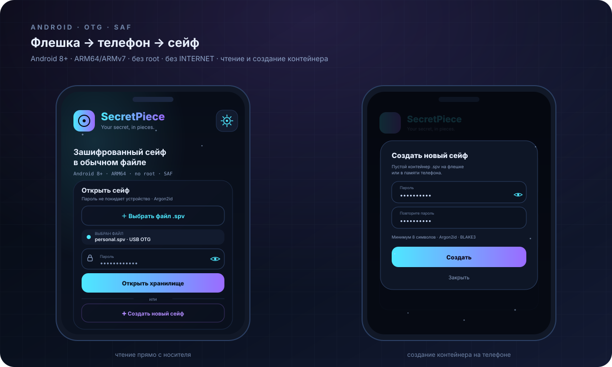

# Android



SecretPiece для Android — тот же контейнер `.spv`, что и на десктопе, но
открытый прямо с флешки, подключённой по OTG/USB-C. Без root, без драйверов и
без доступа ко всем файлам устройства.

## Сценарий

1. Подключите USB-флешку к телефону через OTG-переходник (или USB-C флешку).
2. Система смонтирует её (exFAT/NTFS/ext4/FAT32 — что поддерживает телефон).
3. Нажмите **«Выбрать файл .spv»** и укажите контейнер на флешке — это может
   быть файл с любым именем и расширением (`.spv`, `.bin`, `.mp3`): формат
   определяется заголовком, а не именем.
4. Введите пароль.
5. Смотрите список папок и файлов, открывайте текстовые файлы для предпросмотра.

Новый пустой контейнер создаётся на телефоне: **«Создать новый сейф»** →
пароль и повтор → системный пикер «Сохранить как» → файл пишется сразу на
флешку или во внутреннюю память. Имя тоже любое: маскировка не меняет формат.
Наполнять его удобнее с ПК через `sp-cli`.

Можно и наоборот: открыть контейнер в любом файловом менеджере — SecretPiece
зарегистрирован на `VIEW`-intent (в том числе для `application/octet-stream`,
`audio/mpeg`, `image/jpeg`) и получит content URI.

## Как читается контейнер

Приложение не копирует `.spv` во внутреннюю память. Оно берёт
`ParcelFileDescriptor` через Storage Access Framework, вызывает `detachFd()` и
передаёт дескриптор в Rust-ядро (`sp-ffi`), где он превращается в `File` и
открывается через `Vault::open_file`. Argon2id, XChaCha20-Poly1305 и BLAKE3
работают в общем крейте `sp-vault` — том же, что и в GUI/CLI.

Мост `sp-ffi` — **чтение и создание**: `list`, `read`, `info`, `verify`,
`close` и `createFd` для нового пустого контейнера. Изменения существующего
сейфа — через десктопное приложение или `sp-cli`.

## Что такое `.spv`

Подробно: [`SPV.md`](SPV.md). Коротко: это обычный файл с зашифрованным
сейфом внутри. Расширение `.spv` не важно — формат определяется заголовком,
поэтому файл можно переименовать в `photo.jpg` или `backup.dat`, и он
по-прежнему откроется (если это действительно контейнер SecretPiece).

## Маскировка приложения

В разделе **«Дополнительно»** есть опциональный переключатель
**«Маскировка приложения»**. Когда он включён:

- в лаунчере вместо `SecretPiece` показывается **«Калькулятор»** с иконкой
  калькулятора;
- при открытии «Калькулятора» запускается SecretPiece;
- контейнер `.spv`, его имя и пароль **не меняются** — это только внешний вид
  приложения.

Выключите переключатель в том же разделе, чтобы вернуть иконку и название.
Настройка хранится в `SharedPreferences` и переприменяется при запуске.

Технически используются два `activity-alias` (`LauncherSecretPiece` и
`LauncherCalculator`); выбор переключается через
`PackageManager.setComponentEnabledSetting`. Разрешений это не требует.

> Маскировка приложения не прячет сам файл-контейнер и не заменяет скрытый том.
> Чтобы замаскировать файл, переименуйте его и/или используйте скрытый том.

## Статус

| Часть | Статус |
|---|---|
| UI на Compose (RU/EN) | ✅ |
| Системный выбор файла (SAF) | ✅ |
| Открытие `.spv` из файлового менеджера | ✅ |
| Маскировка приложения (калькулятор) | ✅ |
| Поле пароля и экран разблокировки | ✅ |
| Argon2id / XChaCha20-Poly1305 / BLAKE3 | ✅ v1.4, через `sp-ffi` |
| Просмотр папок и чтение файлов | ✅ v1.4 (только чтение) |
| Создание нового сейфа на телефоне | ✅ v1.5 (диалог с паролем и повтором) |
| Настройки: язык, атмосфера, маскировка, ярлык | ✅ v1.4 |
| Живой фон: снег / дождь / солнце | ✅ v1.4 |
| Запись/удаление файлов на телефоне | ⏳ позже |
| Предпросмотр изображений | ⏳ позже |

## Сборка

Нужны JDK 17, Android SDK (compileSdk 34), NDK и Rust-цели Android:

```bash
rustup target add aarch64-linux-android armv7-linux-androideabi
cargo install cargo-ndk
cargo ndk -t arm64-v8a -t armeabi-v7a \
  -o android/app/src/main/jniLibs build --release -p sp-ffi
cd android
gradle assembleDebug
# APK: app/build/outputs/apk/debug/app-debug.apk
```

Либо откройте папку `android/` в Android Studio (`.so` из `jniLibs` подхватится
автоматически). CI делает то же самое: собирает `libsp_ffi.so` через NDK и
кладёт рядом с Kotlin-кодом.

## Безопасность

- В приложении **нет разрешения `INTERNET`** — данные не покидают устройство.
- Доступ к носителю — через Storage Access Framework: приложение получает
  content URI, а не сырой блочный доступ.
- Ключ живёт в памяти Rust-ядра и зануляется при `close`/выходе.
- Android может кэшировать превью экспортированных файлов; встроенный
  просмотрщик показывает только текст, без записи на диск.
- Флешку можно выдернуть в любой момент: чтение не изменяет контейнер.
